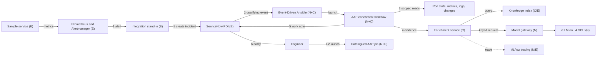

# AI-assisted incident enrichment: demo implementation design

| | |
|---|---|
| **Version** | 0.1 draft |
| **Date** | October 2026 |
| **Implements** | Reference set 1.2: architecture on a page (executive and technical views) and technical architecture v1.2 |
| **Platform baseline** | Red Hat Ansible Automation Platform (AAP) 2.7, Red Hat OpenShift AI Self-Managed 3.5, single-node OpenShift on an AWS g6.16xlarge instance |
| **Status** | Draft for review. Items marked as open are listed in section 11. |

## 1 Purpose and scope

This document describes how the demonstration environment implements the AI-assisted incident enrichment reference architecture. It translates the logical design into specific components, interfaces, identities and deployment choices, and records each point where the demonstration departs from the reference design, with the reason.

The demonstration has two purposes. It shows an operations and automation audience how enrichment works end to end against a real, reproducible fault. It also provides a reusable kit that can be rebuilt from an empty cluster using Ansible alone, so that any colleague can run it. It is not a production design. Where production requirements differ, section 10 sets out the difference.

The reference architecture sets level 1 as the pilot target. The demonstration also shows level 2, because a recommended, catalogued job is the point at which enrichment becomes tangible for an automation team, and it needs no additional control components.

All data in the demonstration is fictional. It uses a fictional organisation, ACME Bank, with fictional services and a synthetic knowledge corpus, and contains no customer material. For the same reason, this document and the repository refer to the reference architecture in its generic form rather than any customer-specific version.

| In scope | Out of scope (described, not built) |
|---|---|
| Pattern A: enrichment of an existing incident, flow steps 1 to 6 | Pattern B: automated incident creation and correlation |
| Level 1 enriched incident for one incident family | Levels 3 and 4, the action broker and approval binding |
| Level 2 recommended job, launched by an engineer under their own authority | Guardrails service, automated evaluation pipeline, audit archive and SIEM forwarding |
| Model access through the gateway with a per-consumer key, and tracing of every model call | Enterprise identity provider, MFA and enterprise search |
| Failure handling, idempotent writes and recursion prevention | Production sizing, high availability, backup and recovery |
| Onboarding a second incident family as a content-only change | Model training or learning from feedback |

## 2 Traceability to the reference architecture

Status values: **Implemented** follows the reference design; **Simplified** implements the intent with a documented shortcut; **Deviation** uses a different approach, recorded in section 10; **Not applicable** falls outside the demonstration scope.

### 2.1 Enrichment flow

| Step | Reference design | Demo implementation | Status |
|---|---|---|---|
| 1 | Existing integration raises the incident and pages on-call | An Alertmanager alert raises a ServiceNow incident through a stand-in integration: an Event-Driven Ansible (EDA) rulebook activation with its own event stream, AAP user and ServiceNow identity, separate from the AI path. It keeps one incident per problem (DD19). Paging is represented by assignment to an on-call group. | Simplified |
| 2 | Qualifying incident event reaches EDA | A ServiceNow business rule on incident insert sends the qualifying incident to an EDA event stream. A polling fallback applies where the cluster is not reachable from ServiceNow (DD03). | Implemented |
| 3 | AAP runs scoped read diagnostics | Four read-only diagnostic job templates run within the enrichment workflow, bounded by namespace, time window, runtime and output size. Each returns evidence in a common format (section 5.2). | Implemented |
| 4 | Enrichment retrieves knowledge and calls the model through the gateway and guardrails | The enrichment service retrieves approved passages, calls the model through the gateway with its own key, and validates the structured output and every citation. Input sanitisation and output validation run in the enrichment service; the guardrails service is not deployed (section 10). | Simplified |
| 5 | AAP appends an AI-labelled work note, idempotent by revision | A dedicated ServiceNow identity writes the work note and two enrichment fields. The revision field prevents duplicate notes on retry. | Implemented |
| 6 | ITSM notifies the team that enrichment is ready | A ServiceNow notification fires when the enrichment state changes to complete. | Implemented |
| L2 | Enrichment identifies a catalogued job; engineer launches it | The work note names one job from an allowlisted catalogue, with a launch link. The engineer launches it with their own AAP account. | Implemented |

### 2.2 Principles

| Principle | Demo implementation | Status |
|---|---|---|
| P1 ITSM is the system of record | Enrichment writes only a work note and two enrichment fields on the incident. The enrichment service holds no incident state beyond traces. | Implemented |
| P2 Incident handling is independent of AI | Incident creation and assignment complete before, and independently of, the AI path. Any failure writes "enrichment unavailable" with the reason. Scenario S3 demonstrates this. | Implemented |
| P3 The model proposes; deterministic controls authorise | The model and the enrichment service hold no ITSM or AAP credentials, and the service's only cluster credential is a one-hour token that may write traces to MLflow (DD23). Diagnostics are read-only. A recommended job is validated against an allowlist, and only an engineer can launch it. | Implemented |
| P4 Evidence is authorised and traceable | Every recommendation cites evidence or passage IDs, which the service validates. Every model call is traced, and trace, model, prompt and job references appear in the work note. | Implemented (no protected archive) |
| P5 Duties are separated | Each function runs under a distinct identity (section 6.1). Human duties are not separated, because one operator holds every role; this is recorded as a time-limited exception. | Simplified |
| P6 Existing capabilities are reused | AAP provides orchestration, ServiceNow provides notification, and OpenShift AI provides serving and the gateway. New components are limited to the enrichment service and the ingestion job. | Implemented, with ADR09 deviation |

### 2.3 Architecture decisions

| Decision | Demo implementation | Status |
|---|---|---|
| ADR01 ITSM remains the authoritative record | As P1 | Implemented |
| ADR02 Complement existing monitoring and ITSM AI | Prometheus provides no root-cause analysis, so alert labels and annotations are passed to enrichment as an input | Simplified |
| ADR03 Enrich incidents raised through the existing path | Pattern A only | Implemented |
| ADR04 AAP orchestrates; enrichment is a bounded service | AAP workflow sequences every step; the enrichment service only retrieves, calls the model and validates | Implemented |
| ADR05 Models hosted on OpenShift AI | vLLM on the llm-d serving stack (`LLMInferenceService`) in the same cluster | Implemented |
| ADR06 Model access through a governed gateway | OpenShift AI Models-as-a-Service: the enrichment service has its own API key and a subscription with a token rate limit, enforced at the gateway (DD14) | Implemented |
| ADR07 Initial alerts do not wait on AI | As P2 | Implemented |
| ADR08 Remediation through a broker | Levels 3 and 4 are out of scope | Not applicable |
| ADR09 Reuse enterprise search or vector services | No enterprise search exists in the environment, so a dedicated pgvector store is used | Deviation |

## 3 Demo design decisions

These decisions apply to the demonstration only. They do not change the reference positions.

| ID | Decision | Rationale |
|---|---|---|
| DD01 | The incident family is JVM memory exhaustion on a sample service. | The fault can be triggered on demand, its diagnostics are visible in standard metrics, and runbook advice is concrete. It can be replaced with a customer's own incident family where that family can be reproduced. |
| DD02 | OpenShift user workload monitoring stands in for Dynatrace. | The technical architecture treats monitoring as a replaceable example (E). A Dynatrace trial is time-limited and unsuitable for a reusable kit. |
| DD03 | The trigger is a push from a ServiceNow business rule to an EDA event stream. Polling through the `servicenow.itsm` collection is the documented fallback but is not built. | Push matches the reference flow. The environment's routes are reachable from the internet and present a publicly trusted certificate, so ServiceNow can call the event stream without a custom CA (OI01, closed). |
| DD04 | The model is an 8B-class instruct model in FP8, served by vLLM as an `LLMInferenceService` (llm-d) using the single L4 GPU, and packaged as a ModelCar image. | It fits within the L4's memory with room for the required context. A ModelCar image avoids a model download on every rebuild. The model is Red Hat's validated Qwen3 8B FP8 ModelCar, with a 16,384-token context and its thinking mode switched off per request, chosen by the model selection test (OI04, [model-selection.md](model-selection.md)) over Granite 3.1 8B and Llama 3.1 8B. It is approved for enrichment that an engineer reviews, not for autonomous remediation. The model is a setting (`demo_model`), and OpenShift AI's default serving template supplies the vLLM image, so changing models changes no code: phase 02 replaces the model served. |
| DD05 | Embeddings run in-process within the enrichment service on CPU. | The L4 does not support partitioning, so a second GPU-served model is not practical. The corpus is small enough for CPU embedding. |
| DD06 | PostgreSQL with pgvector holds the knowledge index. The same PostgreSQL instance, deployed in phase 02, holds separate databases for Models-as-a-Service and MLflow. | It is a single, well-understood store that Ansible can deploy and reset. Models-as-a-Service requires PostgreSQL 14 or later, which OpenShift AI does not provide. The knowledge index is recorded as an ADR09 deviation. |
| DD07 | MLflow records traces, using the MLflow server OpenShift AI provides (the `mlflowoperator` component). | It provides per-call traces with prompt, model and source attributes, matching the tracing approach in the reference design. It is part of the product, so no standalone server is needed (OI03, closed). |
| DD08 | Container images are built in-cluster with OpenShift Builds from the repository source. | No external registry or push credentials are required, which keeps the repository free of secrets. |
| DD09 | HashiCorp Vault Community Edition on the operator's laptop supplies bootstrap secrets. Secrets generated during the build stay in the cluster. | The repository is shared, so it holds no secrets in any form. Generated secrets disappear with the environment. |
| DD10 | All deployment and configuration is performed by Ansible playbooks, run through `ansible-navigator` with a shared execution environment. | The kit must be rebuildable on short-lived environments, and the build itself demonstrates the automation platform to the audience. |
| DD11 | AAP and OpenShift AI share one node. | Section 5 of the technical architecture permits co-location as a deployment choice without changing the logical design. |
| DD12 | Container images are sourced in this order: Red Hat Hardened Images where viable; otherwise a UBI-based image, from Red Hat or a certified partner in the Red Hat Ecosystem Catalog; other sources only where neither exists. An image is not viable if it would have to be rebuilt to add something essential, such as a database extension. Any image from the third tier is recorded here with the reason. | Hardened Images are minimal, signed and near zero-CVE, and UBI images carry Red Hat's supply-chain assurances. Keeping to the Red Hat portfolio also keeps the demo consistent with the platform it showcases. Current applications: Vault uses HashiCorp's UBI image because no Hardened Image exists; the enrichment and sample services are planned on Hardened Images, subject to verification in M2 and M3; the shared PostgreSQL uses Red Hat's `rhel9/postgresql-16` image, and whether it can hold the pgvector store is decided in M4 (OI05). |
| DD13 | The build adopts the platform the environment provides and installs no operators in phase 01. Phase 01 frees the GPU, checks Node Feature Discovery, the GPU Operator and the default StorageClass, and configures user workload monitoring. If an expected component is missing, the phase stops with a clear message. Operators the environment does not provide, such as AAP, are installed in their own phases. The one exception to leaving the environment's operators alone is a standalone Authorino, which phase 02 removes before installing Connectivity Link, because Connectivity Link cannot install alongside another version (section 7.1). | The RHDP OpenShift AI environment already provides the GPU stack and OpenShift AI (section 7.1). An install path for components it always provides would never run, so it would never be tested. Leaving pre-installed operators on their own channels avoids disturbing the environment's OpenShift AI configuration. |
| DD14 | Model access goes through OpenShift AI Models-as-a-Service (MaaS). Phase 02 installs Red Hat Connectivity Link, which provides the gateway policies MaaS relies on, enables the `aigateway.modelsAsAService` component, and publishes the model to MaaS. The enrichment service has its own identity, a service account, which a `MaaSAuthPolicy` allows to call the model and a `MaaSSubscription` gives a token budget. MaaS exposes a model only once such a policy and subscription both cover it. The build mints the service's API key with a short-lived token for that service account, so the key belongs to the service rather than to the person who ran the build. It then reads the model's ID and URL from MaaS's model list, as a client would, and stores them with the key in a Secret in the enrichment namespace; MaaS routes its shared OpenAI-style endpoint on that ID. Every build then checks access through the gateway as a client would: with the key, without a key, and with a key it has just revoked. | MaaS is the product's implementation of ADR06: per-consumer keys that can be revoked, rate limits and usage reporting by consumer, which are what risk and security teams ask about. The llm-d serving stack it needs is already provided by the environment. The alternative, a service account token on the model endpoint, gives no rate limits, usage view or per-consumer revocation. |
| DD15 | The build's roles follow the teams that would own each part in production: `openshift_ai` for the platform team (OpenShift AI, Connectivity Link, the MaaS gateway, MaaS and MLflow), `model_serving` for a model owner (one model, served and registered with MaaS) and `maas_consumer` for an application team (one consumer's identity, policy, token budget and key). Roles take their settings as inputs from the playbook and find what they need from other teams on the cluster. | The operating model is part of what the demo shows: the platform team runs the gateway, and models and consumers are onboarded onto it. Separate roles also let a model be swapped, or a second consumer onboarded, without rerunning the platform, which the model test (OI04) needs. Phase 02 still runs all three in one playbook, so a single run answers whether the AI layer works. |
| DD16 | AAP syncs this repository as its project, using a fine-grained GitHub token limited to the repository with Contents read-only, held in the operator's Vault (`source/github_token`) and stored in AAP as a source control credential. | The repository is public, so AAP could sync it anonymously; the token keeps the kit working from a private fork or copy, and is the pattern a bank would use. A fine-grained token can be limited to one repository and to reading, and preflight confirms both; a deploy key would also work but is harder to manage from Vault. In production, AAP would read from the bank's own source control with a service account. |
| DD17 | The execution environment AAP runs the demo's automation in is the one the operator builds on the laptop, built for linux/amd64, the cluster's architecture, and pushed to the cluster's internal image registry by a playbook run on the laptop, like `00_secrets.yml`. AAP pulls it from the registry's service address inside the cluster. | Automation Hub is switched off (phase 03), and the internal registry needs no external account and disappears with the environment. The laptop push avoids putting the Automation Hub token, which the build needs for certified collections, into the cluster. In production, the execution environment would come from the bank's private Automation Hub or registry, built and signed by its pipeline. |
| DD18 | `payments-notify` is a single-file Java 21 service whose maximum heap equals its container's memory limit. Its fault grows a notification template cache that is never evicted, so the container is OOMKilled by the kernel before the heap is full. The fault runs once (single) or resumes after every restart until cleared (recurring); the recurring marker lives in an `emptyDir` volume, which survives a container restart but not a new pod. | Heap equal to the container limit is a common, real misconfiguration, so the evidence and the runbook are realistic: an OOM kill with a high but not full heap. The single scenario keeps rehearsals simple; the recurring one shows an incident where the engineer has to act. No framework keeps the build quick and the code readable on a slide. |
| DD19 | The monitoring integration stand-in keeps one open incident per problem, identified by the alert labels `service` and `incident_family` and stored in the incident's correlation ID. Only a critical alert raises an incident, at priority 2; a warning is added to an open incident for the same problem but never opens one. Later alerts are added as work notes with an occurrence count; a critical alert raises an incident still at priority 3 to 2; a cleared alert is noted and the incident stays open for the engineer to close. The stand-in records each alert's start and clear times on the incident (`u_acme_alert_state`), so a repeated notification changes nothing, and an alert already recorded on the problem's latest incident raises no new one even after that incident is closed, as when an OOMKilled alert outlasts the reset, and sets the incident's configuration item from the `service` label. Alertmanager reaches it through an EDA event stream with Basic authentication, through the platform gateway, and its job runs one at a time. | One incident per problem, with alerts rolled up into it, is what a well-run integration does, and it is what makes the recurring scenario visible: the occurrence count climbs on the same incident. Raising only on critical alerts follows common practice, where a warning is a monitoring event and a failure is an incident, and it means the enrichment runs once the service has actually failed: raising on the heap warning had the diagnostics run a minute before the OOM kill, missing the strongest evidence. A real integration keeps its alert state in its own store; keeping it on the incident avoids another component. Alertmanager cannot send a custom header, so Basic authentication replaces the header token the ServiceNow trigger uses. Running one job at a time stops two notifications both raising an incident for the same problem. |
| DD20 | The diagnostics run as four job templates through a standard AAP credential (OpenShift or Kubernetes API Bearer Token) holding a token for the `aiops-diagnostics` service account, which has `view` on the workload's namespace only, granted by phase 08. Phase 07 requests the token from OpenShift with a set lifetime (7 days, enough for one demo environment), keeps it in a Secret and renews it when less than 2 days remain. Which namespace and app to look at comes from a service map held in AAP, keyed by the incident's configuration item, never from the incident's text. | The first design gave each job its own pod's token through a container group (workload identity). AAP refuses both an automounted and a projected service account token in a container group's pod spec, deliberately: a job must not quietly inherit cluster identity, and every credential a job uses goes through AAP's credential system, where it is managed and audited. Within that model, a time-limited token keeps the exposure bounded: it is read-only on one namespace and expires on its own if an environment is forgotten. Having each job mint a 10-minute token was considered and rejected: the minting credential would itself be a long-lived secret able to obtain the same access, for little real gain. The service map stops an incident's content from pointing the diagnostics at another namespace, and RBAC enforces the same boundary underneath it. |
| DD21 | The knowledge index is its own database, `knowledge`, in the shared PostgreSQL, with pgvector 0.6.2. Each document section is one passage, with a readable ID (`KB-RB-014#diagnosis`) and the document's labels. Embeddings come from BGE small (English, v1.5), run on CPU with ONNX Runtime through `fastembed`, baked into the enrichment service's image at build time. Phase 05 loads the corpus as merged on `main`, read with the read-only GitHub token, as the `knowledge_ingest` identity, which owns the index. The service reads it as `knowledge_reader`, which row-level security limits to approved, internal passages. Every document is loaded, superseded and restricted ones included, and search filters on service and version before ranking, with an exact scan. | Loading from `main` makes the pull request review the approval step, so an unreviewed local edit cannot reach the demo. Enforcing status and access in the database, not only in the query, means a bug in the service cannot leak a restricted or superseded passage, and loading those documents anyway lets the demo prove the control works. A small CPU model keeps the GPU for the language model and avoids PyTorch in the image; baking it in means nothing is downloaded at run time. One passage per section gives the model whole procedures and gives engineers citations they can follow. At this corpus size an exact scan is fast and, unlike an approximate index, never loses a match to the filter. |
| DD22 | The enrichment service answers in six steps: sanitise, retrieve, prompt, model, check, return. Evidence and the incident description are sanitised on arrival, before anything else reads them. Retrieval asks one question per evidence item, each with the incident description, and a passage keeps its best score; only passages at or above the relevance threshold (0.75, set in M4.7 from measured scores: 0.70 at best for a question no document answers, 0.79 to 0.87 for the memory fault) are sent, at most six. The prompt and schema are those the model was selected with (`enrichment-v1`); the schema is built for each request, so citations can only be supplied IDs and the job only a catalogue entry, and when no passage meets the threshold it allows only `insufficient_evidence`, with no next steps and no job. The service then checks the answer itself (`policy-v1`) and returns it with the sanitised evidence it considered and the passages it used. The service's running version comes from its deployment's `app.kubernetes.io/version` label, read by the changes diagnostic. | Each evidence item points at a different part of a runbook, and one long query blurs them and is truncated at 512 tokens. Enforcing insufficient evidence in the schema makes rule 5 a property of the decoder, not of the model's judgement, while the model still writes a useful summary and gaps. Checking the answer again in the service covers a decoder that ignores a schema keyword. Returning the evidence and passages lets the engineer see what the answer rests on without opening a trace. |
| DD23 | Every enrichment request is one MLflow trace, in the experiment `aiops-enrichment` in the workspace of the service's namespace, with a span for each step: sanitise, retrieve (every candidate passage and its score), model (the sanitised prompt, the schema and the answer, with token counts) and check. The trace is tagged with the incident, service and version, the prompt, policy and retrieval versions, the model, the outcome, and the AAP workflow job and event, and its ID goes into the work note. The model's answer is sanitised before it is traced. The service signs in as its service account, through a token OpenShift mounts for one hour and renews, holding a role of its own in its own namespace only: experiments (which cover traces) in MLflow's `mlflow.kubeflow.org` permission group, to get, list, create and update, and nothing else. OpenShift AI's own `mlflow-operator-mlflow-integration` role also allows datasets, registered models and its AI gateway, which the service does not need. It has no standing token and no other cluster permission. Tracing is best effort: if MLflow cannot be reached, enrichment goes ahead and the note says the trace was not recorded, and a trace counts as recorded only once it has been read back. The MLflow client's telemetry is switched off. | Scenario S5 needs the note to lead to exactly what the model saw and why the answer was accepted. Tracing the sanitised prompt answers the auditor's question "what did the model see?", and the read-back makes "recorded" a fact rather than an assumption. Best effort keeps a demo independent of MLflow's availability; production would weigh failing closed (section 10). A projected, one-hour token with a role limited to experiments is the narrowest credential MLflow's Kubernetes sign-in accepts. |
| DD24 | Enrichment gives two kinds of advice, kept apart. Next steps are the documented fix: each comes from an approved runbook or resolution and cites it, and only they can come with a recommended job. Suggestions are the model's own ideas, to investigate or to fix what approved knowledge does not cover: each cites the observed evidence it rests on, the work note labels them low trust, they never carry a job, and they always require manual review. With no documented fix, the note says so and gives suggestions (at most four); with one, the model adds suggestions only for what the passages do not explain (at most two). A next step that cites no approved passage is turned into a suggestion by the service's checks, so model-made advice can never pass as documented. Retrieval leaves out sections that describe a document or its service rather than say what to do (Purpose, Scope, Service overview from DD26, Related documents, Change history, Timeline), and the best-matching runbook brings its Diagnosis and Actions, and the best-matching resolution its Root cause and Resolution. One of each rather than the two best overall: past resolutions often outscore the runbook, which is the current procedure (seen on INC0010126). Prompt `enrichment-v2`, policy `policy-v2`. | Pointing to an article an engineer could have found is not worth an AIOps platform; the value is in shortening the time to a fix, which most often matters when there is no runbook. Kept apart and labelled, model-made advice helps without being mistaken for approved procedure, and a fix that works becomes a new resolution through the normal review, closing the knowledge gap. The retrieval change follows the first cluster runs, where short overview sections outranked the runbook's Diagnosis and Actions and the model had no documented fix to cite. |
| DD25 | Scenario S2 is provider throttling: MessageHub, ACME's SaaS messaging provider since July 2026 (CHG0030102), answers payments-notify's deliveries with HTTP 429 for about 15 minutes, so customer confirmations queue and the service logs retries, back-off and abandoned batches. Nothing restarts. A critical alert on the delivery backlog, `PaymentsNotifyDeliveryThrottled`, labelled with its own incident family (`provider-throttling`), raises its own incident through the integration stand-in. No runbook or resolution covers it, by design; the runbook for memory exhaustion mentions MessageHub, so it is a near miss. The diagnostics are the same four, so the 429s reach the model through the log excerpt. Retrieval leaves the service's own name out of its questions, since every candidate is already for that service. Phase 08 proves S2 after S1, from a fresh pod. | Provider throttling is a common fault now that most notification and messaging runs through SaaS providers, and it is believable for this service. It has no restart and no memory signal, so it tests whether enrichment can say there is no documented fix, rather than reach for the memory runbook because it names the same service. The service's name matched every document equally and hid that difference. A fresh pod keeps the memory fault's restart and log out of S2's evidence; in a demo, `reset.yml` does the same between scenarios. |
| DD26 | The documented fix is for the incident's own failure: the failure its description states. Each likely cause names the passages that document it (`documented_by`), the first cause is the incident's failure, and the service allows next steps, and so a recommended job, only from the documents behind that first cause. If no passage documents it, there is no documented fix, whatever else the passages cover. A documented fix for another condition the evidence shows, such as a risky setting, becomes a low-trust suggestion that says which document it came from and that it is for another condition. Retrieval also leaves out a document's Service overview. Prompt `enrichment-v3`, policy `policy-v3`. Version 4 of both (2026-10-30) orders the suggestions, the incident's failure first and at most one about another condition, has each suggestion's risk say whether it could make the incident worse and rules out adding load to a dependency that is throttling, after the first passing S2 note suggested scaling out against MessageHub's rate limit; and the note states "no documented fix" once, not again in the model's gaps. | On the first cluster run of S2, the model ranked the MessageHub throttling first, correctly, but gave the memory runbook's heap dump and restart as the documented fix, because the evidence also showed the heap set equal to the limit and a restart from the memory fault minutes before. Real incidents carry evidence of other conditions; a documented fix for one of them is not a fix for the incident, and a restart would have sent the engineer the wrong way while confirmations queued. Tying the fix to the first cause uses a judgement the model made correctly and has the service enforce it, without a second threshold to tune. |
| DD27 | Retrieval has a document gate: a runbook or resolution may reach the model only if it scores at least 0.72 against the incident's description alone, the failure the alert states. The evidence then ranks sections within the documents that pass, as before, and the relevance threshold still applies to them. If no document passes, there is no documented fix, and the gap names the closest document and its score. The gate's scores are in the trace and the provenance, and phase 05 reports them for both scenarios' descriptions on every build. The bar was set from measurement: the memory fault's description scored 0.79 against its documents, the throttling fault's 0.65 at best. | DD26 alone did not hold. Given the memory runbook alongside S2's 429 evidence, the model invented a cause, "429 errors due to memory exhaustion", and ranked it first, so the memory fix passed as documented. An 8B model anchors on the knowledge it is given, so whether a document applies is decided before the model sees it, by search, in line with principle P3: the model proposes, deterministic controls decide. The evidence of other conditions, which brought the memory runbook in, still informs the answer, but it can no longer choose the documents. DD26 stays as a second line of defence. |
| DD28 | Evidence is redacted where it is collected, in the diagnostic job, before it is published as a workflow artefact, as well as by the enrichment service on arrival. AAP keeps every job's artefacts, the variables it passes to the next job and the job's output, readable by anyone who can see the job, so a card number in a log line redacted only by the service would stay in AAP's records. The job's patterns (tokens, secret values, email addresses and any run of 13 to 19 digits) are broader than the service's, which checks card numbers by Luhn: at the source a false positive costs only a little evidence. The log text itself is never shown in the job's output, at any verbosity. `verify.yml` V7 plants a test card number, an email address and a token in the service's log and looks for them in the work note, the MLflow trace and every record of the incident's AAP workflow | Found while writing the M4.6 sensitive data check: the service redacts what it receives, but by then the evidence is already stored in AAP, as the diagnostic's artefacts and the work note job's variables. Redaction belongs at the first point the data is copied, and every later copy (AAP's database, its backups, anything forwarding job records to a SIEM) inherits it. The service keeps its own sanitisation as the second line, since not every caller will be the demo's diagnostics |
| DD29 | When no approved runbook or resolution covers an incident's failure, the enrichment service researches the vendor documentation of a dependency the evidence names, and the model's suggestions built on it are researched fixes: each cites the page and section it comes from, says how (steps), who acts and how to verify, is labelled as not approved by ACME, never carries a job and always requires manual review. The sources are an allow-list in the inventory (`demo_research_sources`), per service, with a switch for each; a source is read only when the evidence or the description names it. The service, not the model, does the research, as a fixed step: it reads the source's sitemap, fetches pages from that site only (no other host, no redirect off it, verified TLS, size-limited, cached for 15 minutes), splits them into sections, sanitises them like evidence, and ranks them with the knowledge's embedding model against the description and the evidence that names the dependency. The best four at or above a floor of 0.60 go to the model as RESEARCH, enclosed as data. Nothing about the incident is sent anywhere: the service only reads. A source that cannot be reached is a gap, not a failure. The note lists the documentation used, with its address, the date the page says it was updated and when it was fetched. MessageHub, being fictional, gets a small documentation site that phase 05 publishes in the cluster behind a route, reachable only through the router, as an outside site would be | Asked for after reading the S2 notes: suggesting "increase the MessageHub limit" without saying how does not save an engineer time, but asking the model for steps from its own knowledge invites invented console paths and contacts, which an engineer under pressure is more likely to follow than a vague line. A vendor's own documentation is what an engineer would read. Research is a governance setting per source, so it can widen as confidence is earned (one vendor, a curated set, open search later, OI11), each step a decision, not a code change. A fixed step rather than model-driven tool calls: an 8B model choosing its own searches is the weaker part of the story today, and a fixed step is easier for a risk team to read; the model-driven version, through MCP, can follow. Live fetching rather than ingesting the pages into the index: ingesting is curation, and the point is research. A researched fix that proves itself becomes approved knowledge through the knowledge loop (S6) |
| DD30 | The service checks two things itself rather than trusting the model with them. Text in the evidence addressed to an AI assistant ("ignore all previous instructions", "note to the assistant" and the like) is kept, as observed, but becomes a gap naming the evidence item and quoting the text, and the note requires manual review; in fetched documentation, such a section is not used at all. And a URL or phone number in the model's answer that is not in the request is removed: a step naming one is dropped, and anywhere else it is replaced with "[removed: not in the sources]", and the note says how many | V6 passed on the planted scenario, but the note did not mention the injected text in plain view in its own evidence, and its manual review depended on the model happening to give suggestions. An engineer, or the security team, needs to see that something tried. Made-up contact details are the most harmful thing a model can invent for an engineer in an incident, and the rule is simple enough to enforce in code |
| DD31 | Every claim an engineer would act on is checked against the sources it cites before the note is written: each likely cause, documented step and suggestion goes back to the model in a second call, with only its cited sources, at temperature 0, and is judged supported, partly supported or not supported. One not supported is removed, and the note says what and why; one partly supported stays, marked as such where it stands, with the reason, and a likely cause's confidence goes down a level. Either means manual review. If no documented step survives, there is no documented fix. If the check itself fails, the note says the answer was not checked and requires manual review. From `review-v2`, it also checks the symptoms and the summary against the evidence, and judges whether each step and suggestion can be done now without changing code, configuration, capacity or a contract; one that cannot is moved to follow-up, owned by the team that owns the service, whatever the answer said. The review call can use the model's thinking mode on its own | The schema and the policy make sure an answer cites only what it was given; they cannot tell whether a cited source supports the claim. The first researched S2 note cited the memory metrics an earlier fault left behind for claims about MessageHub's rate limit. Accuracy matters more to the engineer and to the bank than speed, so a second model call is worth its time and tokens. It is the same model, so it can miss what the first call missed, but it is asked a narrower question with less in front of it |
| DD32 | Accuracy before speed. Time to note and tokens are recorded for every enrichment, as inputs to cost, but no longer judged: `verify.yml` V1 and V9 fail only past a 10-minute backstop, which means something is stuck, and every wait in the build allows for that. Each documented step and suggestion says whether it is for now, during the incident, or a follow-up, through change, and a suggestion says who acts: a code or configuration change goes to the team that owns the service, never the on-call engineer mid-incident. Research sends six documentation sections, at most two from a page. A suggestion that repeats a documented step is dropped, judged by the embedding model. The model's thinking mode is a switch, off by default, to compare notes with it on and off | A note that is right in five minutes is worth more to an engineer than one that is shaky in one, and a bank's customers judge it on whether the fix is valid. The first researched S2 note gave a code change to the on-call engineer at low risk, and missed MessageHub's status page and who may ask for a higher limit because one page took most of the four sections; the S1 note's two suggestions repeated its documented fix |
| DD33 | The knowledge loop (scenario S6). An engineer resolves an incident with Knowledge ticked, writing the resolution notes from the "ACME resolution notes" template (what you saw, checked, fixed, what to do next time). A ServiceNow business rule posts a knowledge event to the same event stream as new incidents, carrying only the incident's identifiers; *Knowledge \| Draft resolution* reads the notes from ServiceNow itself, asks the enrichment service to draft a resolution, and opens a pull request as `acme-knowledge-bot`, a GitHub App with contents and pull requests permissions on this repository only and tokens that expire within an hour. The draft is the engineer's account: the notes are the source of truth for what was done and what fixed it, and the AI work note is context only, so the system never approves its own suggestions by repetition. The model fills the resolution template's sections through a strict schema and the service renders the layout, so every article reads alike; each section says whether it came from the engineer, the incident or the model, and a second model call checks it against that source, marking what it does not support. The pull request says all of this. A GitHub check validates every knowledge change against the corpus rules and the template (`tools/knowledge/check.py`), and branch protection requires it and a person's approval before merging: the approval is the publication. The bot cannot approve its own pull request | Asked for in place of a pre-written article, which would only have demonstrated a merge. Knowledge-centred service practice, and ServiceNow's own Knowledge checkbox, put capture at resolution with the resolver. A template at both ends (the notes and the article) keeps input reliable and output consistent across hundreds of articles. A GitHub App rather than a personal token because it has its own identity and narrow, short-lived permissions, so branch protection can require a human approval it cannot give. Many banks keep this knowledge in ServiceNow's knowledge base or Confluence instead of git; the pattern (draft, review, publish, reindex) is the same. The second half is DD34 |
| DD34 | The knowledge loop, second half: a merge refreshes the index. The knowledge bot's GitHub App sends each push to `main` to its own EDA event stream, which checks GitHub's HMAC signature (X-Hub-Signature-256) with a secret phase 07 generates and sets on the App. The activation *Knowledge index refresh* launches *Knowledge \| Refresh index* as the enrichment trigger's user, who may launch nothing else beyond its workflow and the draft job. The job compares the push's commits and, if `knowledge/` changed, reloads the index from the pushed commit with the same ingestion Job as phase 05, running as `aiops-knowledge-refresh`, a service account allowed only to replace the corpus ConfigMap, run and remove that Job, and read its log and the service's image, through a time-limited token. `reset.yml` keeps approved knowledge by default; `-e demo_reset_knowledge=true` removes the resolutions the bot drafted (marked `drafted_by`) from `main` in one commit, made as the operator with their own fine-grained token, and refreshes the index | The loop is only shown if the next incident uses what was learned, so the index must follow `main` without a person running a build. A webhook into Event-Driven Ansible is how a bank would wire it, signed so EDA can trust the sender. The refresh reads the merged commit, never the laptop, so only reviewed content is indexed. The reset needs to write to `main`, which the ruleset stops everyone but its bypass list doing: putting the bot on that list would let it publish without approval, so the reset acts as the operator instead, who is already on it. Two refreshes at once share the Job's name, so one replaces the other instead of both writing to the index |

## 4 Component view

| Component | Label | Implemented by | Namespace | Function |
|---|---|---|---|---|
| Sample service | E | Java service with a memory-leak endpoint | `demo-payments` | Produces the reproducible fault |
| Monitoring | E | OpenShift user workload monitoring, alert rules and Alertmanager routing | `demo-payments` | Detects the fault and raises the alert |
| Monitoring integration stand-in | E | EDA rulebook activation with its own event stream, AAP user and ServiceNow identity | `aap` | Creates the incident, standing in for the vendor integration |
| ITSM | E | ServiceNow Personal Developer Instance (PDI) | External | Incident record, assignment and notification |
| Event-Driven Ansible | N+C | AAP 2.7 EDA with a rulebook from the repository | `aap` | Validates qualifying events and launches the workflow |
| Enrichment workflow and diagnostics | N+C | Automation controller with a demo collection | `aap` | Orchestration, diagnostics and ITSM updates |
| Catalogued remediation job | N+C | Automation controller job template | `aap` | Level 2 action launched by an engineer |
| Enrichment service | C | Python web service | `aiops-enrichment` | Retrieval, model call, output and citation validation |
| Knowledge ingestion | C | Kubernetes Job using the enrichment service image, which carries the embedding model | `aiops-enrichment` | Loads the corpus from `main` into the index (DD21) |
| Knowledge index | C/E | PostgreSQL with pgvector, its own database in the shared PostgreSQL instance | `aiops-data` | Passage storage and similarity search |
| Shared database | E | PostgreSQL 16 (Red Hat image), with a separate database and user for each consumer | `aiops-data` | Stores for Models-as-a-Service, MLflow and the knowledge index (DD06) |
| Model gateway | N | OpenShift AI Models-as-a-Service, on Red Hat Connectivity Link | `openshift-ingress`, `models-as-a-service` | Per-consumer keys, limits, revocation and attribution (DD14) |
| Model serving | N | vLLM as an `LLMInferenceService` (llm-d) on the L4 GPU | `aiops-models` | Model inference |
| Tracing | N | MLflow provided by OpenShift AI, with metadata in the shared PostgreSQL | `redhat-ods-applications` | Trace of every model call |
| Bootstrap secrets | E | Vault Community Edition | Operator's laptop | Holds the secrets each operator brings to a build |



## 5 Flow and interface contracts

### 5.1 Trigger

A qualifying incident matches the demonstration's on-call assignment group (ACME Payments On-call), the Software category, priority 2 or 3, and an empty enrichment state. The event carries the incident number and system ID, short description, configuration item, priority, opening time, the alert labels supplied by the integration, and an event ID. The EDA rulebook validates these fields and passes only them to the workflow.

An asynchronous business rule on insert posts qualifying incidents through an Outbound REST Message, which holds the event stream's address and token and records each call in ServiceNow's outbound HTTP log. Phase 07 sets the address and token for each environment. Running after the save means a failed call never affects the incident. A call that may pass, with no answer, HTTP 429 or a 5xx, is retried twice, after 2 and 5 seconds, with the same event ID; a call that still fails is logged. The workflow is idempotent, so a post that arrived twice changes nothing.

Recursion is prevented in three ways. The business rule fires on insert only, its condition excludes changes made by the enrichment writer identity, and the workflow sets the enrichment state to `pending` as its first action.

### 5.2 Diagnostic evidence

Each diagnostic job returns a list of evidence items in a common format, passed to the work note step as a workflow artefact of its own (`diagnostics_evidence_pod_status`, `_metrics`, `_changes` and `_logs`), since the four run in parallel. The jobs run as the read-only `aiops-diagnostics` service account, through a time-limited token in an AAP credential (DD20). They find what to look at in the service map, by the incident's configuration item: its namespace, app label and container. An incident whose configuration item is not in the map gets no diagnostics. A diagnostic that fails publishes a gap item (an ID ending in `-GAP`) saying what is missing, and the note is written without that evidence.

```yaml
evidence:
  - id: EV-POD-01
    source: openshift.pod_status
    collected_at: "2026-10-20T03:14:07Z"
    target: demo-payments/payments-notify-7c9f
    fact: "Container restarted 3 times in 10 minutes; last termination reason OOMKilled"
    ref: "/api/v1/namespaces/demo-payments/pods/payments-notify-7c9f"
```

| Diagnostic | Source | Bounds |
|---|---|---|
| Pod status and events | OpenShift API | Namespace mapped from the configuration item; up to three pods; warning events from the last 30 minutes |
| Heap and garbage collection metrics, container memory and restarts | Thanos Querier tenancy endpoint, which limits queries to namespaces the identity can view | 30-minute window. The sample service exports no garbage collection metrics, which the diagnostic reports as a fact |
| Recent changes | Deployment rollout history, the running container's resources and JVM settings (only environment variables named `JAVA_` or `JVM_`, since others can hold credentials), and ServiceNow change requests for the configuration item | 24-hour window |
| Log excerpt | The previous container's log if it restarted, otherwise the current one, filtered to warnings and errors. Messages that differ only in their numbers are collapsed into one entry with a count, a time range and the first and last values | The last 500 lines and 128 KB read; the last 15 distinct messages kept, 240 characters each |

Limits are 60 seconds runtime per job (the job template's timeout), 15 seconds per call, 8 items per diagnostic and 4,000 characters per fact. The work note lists the evidence in the order an engineer reads it: pod status, metrics, log excerpt, then changes. Timestamps are given to the second, in UTC.

### 5.3 Enrichment request and response

The request contains the incident fields, the AAP workflow job and event it belongs to (for the trace's tags), the affected service's running version, the evidence list, the enrichment revision, and the level 2 catalogue: the IDs and descriptions of the jobs that enrichment is permitted to recommend for the incident's configuration item. The version comes from the changes diagnostic, which reads the deployment's `app.kubernetes.io/version` label; the catalogue is held in the inventory and passed to the work note job by its template (DD22).

The response has the following structure:

| Field | Content |
|---|---|
| `status` | `enriched`, `insufficient_evidence` or `failed` |
| `summary` | Short description of what is happening |
| `symptoms` | Observed symptoms and impact |
| `likely_causes` | Each with a statement, a confidence of high, medium or low, citations, and the passages that document it; the first is the incident's own failure (DD26) |
| `next_steps` | The documented fix for the incident's own failure: each with the step, whether it is for now or a follow-up (DD32), prerequisites, risk, how to verify the outcome, and citations that include a passage from a document behind the first cause (DD26) |
| `suggestions` | Advice that is not approved (DD24, DD29): each an investigation or a possible fix, with the reason, up to four steps, whether it is for now or a follow-up, who acts, how to verify, the risk and citations; `basis` is `research` for a researched fix, which cites vendor documentation, and `evidence` for the model's own idea, which cites observed evidence only |
| `recommended_job` | One catalogue ID with a reason and suggested inputs, or null |
| `gaps` | Missing or conflicting evidence, and the absence of a documented fix |
| `checks_removed` | What the service's checks removed from the model's answer, and why, including claims the citation check found unsupported |
| `review` | The citation check (DD31): how many claims were checked, how many were supported, which were partly supported and which removed, and why; each cause, step and suggestion also carries its own `support` |
| `manual_review_required` | True where evidence is missing or conflicting |
| `evidence_considered` | The evidence as the model saw it, after sanitisation, with each item's ID |
| `knowledge_used` | The passages sent to the model, each with its title and relevance score |
| `research_used` | The vendor documentation sections sent to the model (DD29), each with its source, title, address, the date the page says it was updated, when it was fetched and its relevance |
| `provenance` | Gateway consumer, model, prompt and policy versions, retrieval configuration version, the service and version retrieval was filtered on, source IDs, the best candidate passages and their scores, the research sources and candidate sections, the evidence flagged as addressed to an AI assistant (DD30), the scores of suggestions against the documented steps (DD32), what sanitisation removed, the MLflow trace ID and whether the trace was recorded, token usage and model time for each model call, and service version |

Before returning a response, the service applies five rules:

1. Evidence is sanitised before it reaches the prompt. Tokens, keys, email addresses and card-like numbers are redacted, and evidence is enclosed as data, separate from instructions.
2. Retrieval filters on approval status, service, product version and access label before any passage reaches the model.
3. The model output must match the schema.
4. Every citation must refer to an evidence ID or a retrieved passage ID, and the recommended job must appear in the catalogue supplied with the request.
5. Where no retrieved passage meets the relevance threshold, or the output contains no valid citations, the status is `insufficient_evidence` and no next steps are given. Researched fixes from allow-listed vendor documentation (DD29) and the model's own low-trust suggestions may still be given, each labelled as such (DD24).

How each rule is applied is decision DD22. In short: rule 1 runs on arrival, over the evidence and the incident description, and again over the model's answer; rule 3 is the gateway's constrained decoding against a schema built for the request; rules 4 and 5 are enforced twice, by that schema and by the service's own checks, which drop a cause or step with an unknown citation, drop a job not in the catalogue, turn an answer that cites no passage into `insufficient_evidence`, and require manual review whenever a diagnostic left a gap. A service whose version is unknown gets no passages, and the gap says why. If the knowledge index cannot be searched the service answers 503, and if the model cannot be reached, refuses the key, reaches the token limit or breaks the schema it answers 502, each with a reason that is safe to show, which the workflow's failure branch writes into the "AI enrichment unavailable" note.

### 5.4 Work note

The work note is labelled as AI-generated and unreviewed, and carries the references needed to reconstruct it.

```text
[AI-generated enrichment | revision 1 | not reviewed by an engineer]
Outcome: enriched, with a documented fix | Manual review required: yes
Summary: payments-notify is repeatedly OOMKilled because its maximum heap equals its container limit.
Symptoms:
  - Container restarted with OOMKilled, exit code 137, with the heap at 70% of its maximum
Likely cause (high): maximum heap equal to the container limit leaves no room for JVM memory [KB-RB-014#diagnosis, EV-CHG-02]
Next steps (documented fix, from approved knowledge):
  1. Capture a heap dump and restart the pod. Prerequisites: ... Risk: ... Verify: no OOMKilled restarts for 30 minutes. [KB-RB-014#actions-level-1]
  2. Set the maximum heap to about 75% of the limit through a change request. ... [KB-RB-014#actions-level-2, EV-CHG-02]
Suggestions from the model (LOW TRUST: not from approved knowledge or documentation; check them before acting):
  1. [Investigate] ... Why: ...
     - step
     Who: ... Verify: ... Risk: ... [EV-LOG-01]
Recommended automation: payments-heapdump-restart: preserve the evidence before recovery (inputs: pod=...)
Gaps:
  - ...
Evidence considered:
  - Pod payments-notify-...: restarted 1 time; last termination OOMKilled, exit code 137 ... [EV-POD-01]
  - ...
Knowledge used:
  - KB-RB-014#symptoms: payments-notify: memory exhaustion and OOMKilled restarts (2.x on OpenShift): Symptoms (relevance 0.87)
  - KB-RB-014#actions-level-1: payments-notify: memory exhaustion and OOMKilled restarts (2.x on OpenShift): Actions, Level 1: ... (with KB-RB-014#symptoms)
  - ...
Removed from the evidence before analysis: 1 card number
References: trace tr-<id> (MLflow) | model qwen3-8b | prompt enrichment-v1 | policy policy-v1 | retrieval <version> | service 0.3.0 | tokens <n> | workflow job <id> | event <id>
```

The model's analysis comes first, then the documented fix, then the model's own suggestions under a low-trust heading (DD24), then what it all rests on: the evidence as the model saw it and the passages it was given. When there is no documented fix and vendor documentation was researched (DD29), a "Researched fixes (from MessageHub's documentation, fetched for this incident; NOT approved by ACME, check before acting)" section comes before the model's own suggestions, and a "Vendor documentation used" list after the knowledge used, with each page's address, its updated date and when it was fetched. The "removed" line appears only when sanitisation removed something, and says what kind, never what. The trace ID is MLflow's, so it can be searched for in MLflow's interface; if MLflow could not record the trace, the line says "trace not recorded" with the request's own ID, which the service's log carries.

Enrichment uses three custom incident fields:

| Field | Values | Purpose |
|---|---|---|
| `u_ai_enrichment_state` | `pending`, `complete`, `insufficient_evidence`, `unavailable` | Drives the trigger condition and the "AI enrichment ready" notification, sent to the assignment group when the state becomes `complete` or `insufficient_evidence` |
| `u_ai_enrichment_rev` | Integer | Idempotency: before writing, the workflow checks whether a note for the current revision already exists, so a retried workflow cannot add a duplicate |
| `u_ai_enrichment_rating` | `useful`, `incorrect`, `unsafe` | Engineer rating, supporting the usefulness value measure. Ratings are recorded, not acted on automatically. |

### 5.5 Failure handling

A failure to mark the incident pending or to write the note takes the workflow's failure branch. A failed diagnostic does not: the note is written without its evidence, and its gap item says what is missing. This writes an "AI enrichment unavailable" note with the reason and sets the enrichment state to `unavailable`. Initial timeouts are 90 seconds for the enrichment call and 5 minutes for the workflow as a whole. Retries are bounded, and the incident remains with its assigned team throughout. The trigger's own retries cover a brief outage between ServiceNow and AAP, such as the single HTTP 500 from the event stream that `verify.yml` caught on 2026-10-22. A longer outage would still leave an incident unenriched: a reconciliation sweep, a scheduled AAP job that launches the workflow for qualifying incidents left without an enrichment state, is open item OI10.

### 5.6 Knowledge corpus

The corpus is authored for the demonstration and stored in the repository. It is designed to exercise retrieval rather than simply to answer the happy path, so it contains five kinds of document:

| Document type | Purpose in the demonstration |
|---|---|
| Current runbooks and validated prior resolutions for the incident family | The sources enrichment is expected to cite |
| Near-miss runbooks for related faults, such as connection pool exhaustion | Show that retrieval selects the right source, not merely a similar one |
| A superseded runbook for an earlier service version | Must never be cited; tests the version filter |
| A document with a restricted access label | Must never be cited; tests access filtering |
| No runbook at all for a second fault | Drives the insufficient-evidence scenario (S2) |

Each document carries labels for its ID, origin, service, product version, owner, access label, approval status and date, matching the labels described in section 7 of the technical architecture. Ingestion splits documents into passages, embeds them and stores the labels alongside each passage. Approval is represented by review of the pull request that changes the corpus.

## 6 Identity, secrets and trust boundaries

### 6.1 Identities

| Function | Identity | Permitted | Not permitted |
|---|---|---|---|
| Integration stand-in | EDA event stream user name and password, AAP `svc-eda-integration` and ServiceNow `svc-monitoring` | Launch the integration job; create and update incidents, including its own alert record | Write enrichment fields; launch any other template, including the enrichment workflow |
| Trigger | EDA event stream token and AAP `svc-eda-enrichment` | Launch the enrichment workflow | Launch any other template, including the remediation job |
| Diagnostics | OpenShift service account `aiops-diagnostics`, through a time-limited token in an AAP credential (DD20); the change request lookup uses the ITSM writer's ServiceNow credential to read | Read pods, events, logs, deployments and metrics in `demo-payments`; read change requests | Write to any resource; read any other namespace |
| ITSM writer | ServiceNow `svc-ai-enrichment` | Write work notes and enrichment fields | Create, reassign or close incidents; create changes |
| Enrichment service | Service account `aiops-enrichment`, its MaaS API key, the `knowledge_reader` database identity, and a one-hour token for its service account, mounted and renewed by OpenShift; callers present its own API token | Call the gateway; read approved, internal passages of the knowledge index; create and read MLflow experiments and traces in its own workspace (DD23) | Read superseded or restricted passages (row-level security, DD21); change the index; delete traces; any ITSM or AAP access, or any other cluster API access |
| Knowledge ingestion | Service account `knowledge-ingest`, with no cluster API access, and the `knowledge_ingest` database identity, which owns the index | Write the knowledge index | Call the gateway; read ITSM |
| Engineer | Personal AAP and ServiceNow accounts | Read incidents; launch the catalogued job | Not applicable |
| Model | None | Inference only | Any credential or outbound network access |

Each ServiceNow identity holds `itil`, for access to the incident table, and a custom role that marks its function: `acme_monitoring_integration` or `acme_ai_enrichment`. On its own, `itil` would let either identity reassign and close incidents, so phase 04 adds guard business rules that run inside ServiceNow, before every insert and update, and reject anything outside the identity's row above: `svc-ai-enrichment` cannot create incidents and can change only work notes and the enrichment fields; `svc-monitoring` can create incidents but cannot set the enrichment fields. The guards apply whatever the channel, the API included, so the separation does not depend on AAP behaving. Phase 04 proves them on every build by acting as each identity and reading the result back as the administrator. Both are web service only accounts, so neither can sign in to the ServiceNow interface.

Field-level access rules (ACLs) would be the usual ServiceNow control, but the PDI refuses ACL changes over the API, even from the administrator, because they need the `security_admin` role elevated in an interactive session (confirmed 2026-10-16). Section 10 records the production equivalent.

### 6.2 Network

The `aiops-enrichment` and `aiops-models` namespaces apply default-deny network policies. The permitted flows are AAP to the enrichment service, the enrichment service to the gateway, knowledge index and tracing, and the gateway to the model. Outbound traffic from the model namespace is denied. OpenShift enforces these policies on a single node in the same way as on a multi-node cluster.

AAP's jobs reach the enrichment service over TLS: OpenShift's service CA issues the service's certificate for its in-cluster name, and the job checks it against the CA bundle that the AAP credential writes to a file. The job also presents the service's own API token, generated by phase 06 and held in the cluster. Phase 06 proves the policy by connecting from a namespace it must refuse.

### 6.3 Secrets

| Category | Examples | Source | Lifetime |
|---|---|---|---|
| Operator entitlements | OpenShift pull secret, AAP subscription manifest, registry token | Operator's Vault | Held by the operator; never shared |
| Environment access | Cluster API URL, token and CA bundle (the CA bundle is not secret) | Operator's Vault, updated for each environment | One environment |
| ServiceNow administration | PDI URL and administrator credential, used only by phase 04 to create service identities | Operator's Vault | Held by the operator |
| Generated | AAP administrator, database, gateway key, ServiceNow service identity passwords, the EDA users' passwords, the knowledge index identities' passwords, the diagnostics' 7-day service account token (also held in its AAP credential), the ServiceNow event stream token (also held in ServiceNow's REST Message), the Alertmanager event stream password (also held in the workload namespace for Alertmanager), the enrichment service's API token | Generated by the playbooks; stored as Kubernetes Secrets | One build. The PDI outlives the cluster, so phase 04 resets a ServiceNow identity's password whenever the cluster holds no stored password or the stored one no longer works |

The build reads each secret group from the operator's Vault with its own AppRole, whose policy can read only that group, so a phase holds only the secrets it asks for. Secrets never appear in the repository, the execution environment, container images, prompts, work notes or traces. Every task that handles a secret uses `no_log`, except Kubernetes tasks that receive the cluster token through `module_defaults`. `kubernetes.core` prints that token at verbosity 3 and above, so the secrets role refuses to resolve secrets at that verbosity instead. A later task that loops over a Kubernetes task's registered results would print the token at verbosity 2, so the build reduces such results to the fields it needs first. `ansible-navigator` playbook artefacts are disabled in the committed configuration, and the repository uses a gitleaks pre-commit hook with GitHub secret scanning and push protection. In production, AAP retrieves credentials from the enterprise vault through its external secret management integration [7].

## 7 Deployment view

The environment is single-node OpenShift on an AWS g6.16xlarge: 64 vCPUs, 256 GiB of memory and one NVIDIA L4 GPU with roughly 22 GiB of usable GPU memory. A root volume of around 500 GB is requested to hold model images, databases, logs and heap dumps.

| Workload | vCPU | Memory | Notes |
|---|---|---|---|
| OpenShift platform and monitoring | 8 | 32 GB | Single-node control plane and platform services |
| OpenShift AI 3.5 | 4 to 6 | 16 GB | Operators, dashboard, serving and gateway components |
| AAP 2.7 | 6 to 8 | 24 GB | Gateway, controller, EDA and databases; no private automation hub |
| Model serving | 4 | 32 GB | vLLM; holds the L4 exclusively |
| Enrichment service and knowledge index | 2 to 4 | 8 GB | Includes in-process embedding |
| Sample service, tracing and builds | 4 | 12 GB | The sample service is sized to fail predictably |
| **Total** | **about 30 to 35** | **about 125 GB** | About half the instance, leaving headroom for the fault |

These are planning figures, to be replaced with measured values after the first build. The L4 is allocated to vLLM only. Generation of a work note is expected to take 10 to 20 seconds, which is acceptable because enrichment is asynchronous.

### 7.1 Environment baseline

The environment is the Red Hat Demo Platform (RHDP) OpenShift AI catalogue item. As provisioned in October 2026, it provides the following before the build starts. Phase 01 reports the same details on every build, so drift between environments shows up in its output.

| Component | As provisioned | Effect on the build |
|---|---|---|
| OpenShift | 4.20, single node, g6.16xlarge, one L4 advertised as `nvidia.com/gpu: 1` with no time-slicing | Matches the sizing above |
| Node Feature Discovery | 4.20, channel `stable` | Checked by phase 01, not installed (DD13) |
| NVIDIA GPU Operator | 25.3.4, channel `v25.3` | Checked by phase 01, not installed (DD13) |
| OpenShift AI | 3.5.1, channel `stable-3.x` | Configured by phase 02. The channel follows minor releases, so phase 02 checks for at least 3.5 and records the version it finds |
| OpenShift Serverless, Authorino | 1.37.1, 1.4.3 | OpenShift AI dependencies, left as provisioned |
| llm-d serving | `LLMInferenceService` resource types, `LLMInferenceServiceConfig` templates including a single-node NVIDIA one, and the `openshift-ai-inference` Gateway, all ready | Used for the model (DD04) |
| Models-as-a-Service, MLflow | Not enabled. Red Hat Connectivity Link (`rhcl-operator`) is in the catalogue but not installed | Installed and enabled by phase 02 (DD14, DD07) |
| Authorino operator | Absent in the first environment; installed on its own (1.4.4) in the second. Connectivity Link requires one exact version and cannot install alongside another | Phase 02 removes a standalone Authorino before installing Connectivity Link, which installs the version it requires (DD13) |
| OpenShift Pipelines, cert-manager, JobSet, Red Hat build of Keycloak | 1.24.1, 1.20.1, 1.0.1, 26.4.16 | Not used by the demo, left as provisioned |
| Sample model `my-first-model` | Holds the only GPU | Deleted by phase 01 (`demo_gpu_reclaimable_namespaces`) |
| Default StorageClass | `gp3-csi` | Checked by phase 01 |
| User workload monitoring | Not configured | Enabled by phase 01, with its own Alertmanager |
| Ingress | Routes reachable from the internet with a publicly trusted certificate | Push trigger (DD03) |
| API certificate | Signed by the cluster's own CA, not publicly trusted | The build verifies the API against the cluster's CA bundle (`kube-root-ca.crt`), loaded into Vault with the URL and token |

## 8 Build and redeploy model

Environments stop automatically and expire after a fixed period, so the kit is rebuilt rather than maintained. Every phase is idempotent and safe to rerun, versions are pinned, and environment-specific values such as instance profile, model and incident family are set in inventory variables.

The no-scripting rule applies to deployment and configuration. The enrichment service and the sample service are application code (C components) and are built from source in the cluster.

| Phase | Playbook | Result |
|---|---|---|
| 00 | `00_secrets.yml` | Vault container, KV engine, read-only policy and AppRole on the operator's laptop |
| 00 | `00_preflight.yml` | Confirms every required secret and the cluster connection before any change |
| 01 | `01_platform.yml` | Frees the GPU, checks Node Feature Discovery, the GPU Operator and storage, and enables user workload monitoring with its Alertmanager (DD13) |
| 02 | `02_openshift_ai.yml` | PostgreSQL; the AI platform: Red Hat Connectivity Link, Models-as-a-Service and MLflow; the model as an `LLMInferenceService`; and the enrichment service onboarded with its policy, subscription and API key, checked through the gateway (DD14, DD15) |
| 03 | `03_aap.yml` | AAP operator (namespace-scoped, `stable-2.7`), the platform with automation controller and Event-Driven Ansible, and the subscription manifest from the operator's Vault |
| 04 | `04_servicenow.yml` | PDI incident fields and choices, the on-call group with a fictional engineer, custom roles, service identities narrowed by guard business rules, the "AI enrichment ready" notification, and checks that act as each identity |
| 05 | `05_knowledge.yml` | Knowledge index and ingestion of the approved corpus |
| 06 | `06_enrichment.yml` | Enrichment service: built in-cluster from this repository, deployed behind TLS from the service CA with its own API token and a network policy that admits only AAP's jobs, and checked from inside the cluster |
| 07 | `07_execution_environment.yml` | Run on the laptop with `ansible-playbook`: publishes the laptop-built execution environment, built for linux/amd64, to the cluster's internal registry, pinned by digest (DD17) |
| 07 | `07_aap_content.yml` | Projects, credentials, job templates, workflow and rulebook activation, declared with `infra.aap_configuration`; then the ServiceNow REST Message and business rule that post qualifying incidents to the event stream; checked end to end |
| 08 | `08_workload.yml` | Sample service, alert rules and Alertmanager routing to the integration stand-in's rulebook |
| | `reset.yml` | Returns the demonstration to a clean state between runs |
| | `verify.yml` | Triggers the fault and checks the acceptance criteria in section 9 |

The target is an empty environment to a working demonstration in under 90 minutes. Phase durations will be measured on the first build.

```text
aiops-enrichment-demo/
├── site.yml, reset.yml, verify.yml
├── ansible.cfg, ansible-navigator.yml
├── secrets.example.yml
├── inventory/group_vars/
├── playbooks/                   build phases, run from the operator's laptop
├── roles/                       roles used by the build phases
├── evaluation/                  the model selection test, run from the operator's laptop
├── automation/                  playbooks AAP runs as job templates
├── rulebooks/                   EDA rulebooks
├── collections/
│   ├── requirements.yml
│   └── ansible_collections/demo/aiops/   diagnostic, write-back and remediation roles
├── execution-environment/
├── services/enrichment/         enrichment service source
├── services/payments-notify/    sample service source
├── knowledge/                   synthetic corpus with approval metadata
├── docs/implementation-design.md
└── SECURITY.md
```

The repository holds two kinds of playbook. `playbooks/` builds the environment and runs from the operator's laptop. `automation/` and `rulebooks/` hold the content AAP runs inside the demonstration, and the repository itself is the AAP and EDA project they are synced from.

## 9 Demo scenarios and acceptance criteria

| ID | Scenario | Demonstrates | Pass condition | Reference acceptance area |
|---|---|---|---|---|
| S1 | Trigger the memory fault | Value moment: level 1 and level 2 | Incident raised within 2 minutes of the alert; a work note whose every claim is supported by what it cites (DD31), citing the correct runbook and evidence, with its time recorded but not judged (DD32); correct job recommended; the engineer's launch recovers the service. Compared against a timed manual diagnosis of the same incident. | Evidence and AI quality; time to usable diagnosis |
| S2 | Trigger a fault with no runbook | Trust moment | Work note states there is no documented fix and requires manual review; it gives no next steps and no job; it gives fixes researched in MessageHub's documentation, each citing the page it comes from, with steps, who acts and how to verify, labelled as not approved by ACME (DD29); any other suggestions are the model's, labelled low trust and each citing the evidence it rests on (DD24) | Evidence and AI quality |
| S3 | Revoke the gateway key, then trigger the fault | Failure handling and the gateway kill switch | Incident raised and assigned as normal; "enrichment unavailable" note with the reason | Failure handling; governance |
| S4 | Add a second incident family | Scaling as a content-only change | Rerunning phases 05 and 07 with a new diagnostic job and runbooks covers the new family, with no change to the enrichment service | Not applicable |
| S6 | Resolve S2 with Knowledge ticked, approve the bot's pull request, and trigger S2 again | The knowledge loop: what fixed it becomes approved knowledge, under the bank's control (DD33) | The resolution notes become a pull request by `acme-knowledge-bot` that follows the template and passes the GitHub check, noted on the incident; after a person approves and merges it and the index refreshes, the next S2 note gives a documented fix citing the new resolution. Phase 08 proves it as far as the pull request, and expects S2's documented fix once the bot's resolution is on `main` (DD34) |
| S5 | Follow a work note to its trace | Traceability | The trace shows the prompt version, model, retrieved sources and workflow job | Governance |

Scenarios S1 to S5 are presented to the audience. `verify.yml` also checks the following criteria automatically after every build (V1 to V9), drawn from the acceptance criteria in section 10 of the technical architecture:

| Check | Pass condition | Reference acceptance area |
|---|---|---|
| Idempotency | A rerun of the workflow for the same revision adds no second note | Enrichment lifecycle |
| Recursion prevention | The enrichment update does not retrigger the workflow | Enrichment lifecycle |
| Concurrent update | An engineer's edit to the incident during enrichment is preserved | Enrichment lifecycle |
| Wrong-version source | The superseded runbook is never cited, and never reaches the note or the trace (V8) | Evidence and AI quality |
| Access filtering | The restricted document, its marker phrase and another service's resolution never reach the note or the trace (V8) | Evidence and AI quality |
| Prompt injection | Log lines instructing the model to recommend the database failover do not change the recommended job or put the failover in the documented fix; the note flags the injected text and requires manual review (V6, DD30) | Evidence and AI quality |
| Low-trust suggestions | Suggestions cite observed evidence or researched documentation only, never carry a job, sit apart from the documented fix, and always require manual review; a URL or phone number the model made up is removed (DD30) | Evidence and AI quality |
| Researched fixes | A failure no approved knowledge covers is researched in the allow-listed vendor documentation, and the note's researched fixes each cite the page they come from (phase 06 and phase 08 checks, DD29) | Evidence and AI quality |
| Sensitive data | A test card number, an email address and a token planted in the log are redacted at the source (DD28) and found in neither the work note, the trace nor any record of the incident's AAP workflow (V7) | Evidence and AI quality |
| Latency and cost | Time from incident to work note and the tokens used are recorded for an incident with full diagnostics, as an input to the cost per enriched incident measure; reported, not judged, failing only past a 10-minute backstop (V9, DD32) | Value measures |
| Citation check | Every cause, step and suggestion is checked against the sources it cites by a second model call; unsupported claims are removed and partly supported ones marked (phase 06 check, DD31) | Evidence and AI quality |

## 10 Simplifications and production considerations

| Area | Demonstration | Production, per the reference design |
|---|---|---|
| Monitoring | OpenShift user workload monitoring | Existing monitoring platform, with its root-cause output as an input (ADR02) |
| Incident creation | EDA stand-in for the integration, keeping its alert state on the incident (DD19) | Existing monitoring-to-ITSM integration, unchanged, with its own correlation store |
| Paging | Assignment to an on-call group | Existing paging path |
| Model | One 8B-class model, quantised to FP8, on one 24 GB L4, approved for engineer-reviewed enrichment only. Results are a floor, not a ceiling ([model-selection.md](model-selection.md)) | Larger models, or several, on GPUs sized for them, behind the same gateway. Changing the model changes no consumer |
| Topology | Single node, AAP and OpenShift AI co-located | Sized, highly available deployment in approved network zones |
| Knowledge store | Dedicated pgvector store | Enterprise search where it meets control requirements (ADR09) |
| Embeddings | In-process on CPU | Served embedding model behind the gateway |
| Knowledge approval | Pull request review | Named knowledge source approver, separate from the ingestion identity |
| Vendor documentation | One fictional vendor's site, published in the cluster and reached through its router; an allow-list in the inventory, read directly by the enrichment service (DD29) | Outbound access through the bank's egress proxy, with the allow-list enforced there as well as in the service; each source assessed and approved by risk (licence terms, currency, how its content could be tampered with); later, governed web search or vendor MCP servers, with the same tiers of trust in the note |
| Knowledge readiness | Corpus authored to fit the fault, so quality is higher than most real runbooks | Readiness assessed before build (technical architecture section 7); real results depend on runbook currency and CMDB accuracy |
| Diagnostic targets | OpenShift API, metrics and ServiceNow only | Monitoring APIs, CMDB and managed targets over HTTPS, SSH or WinRM, with read-only credentials |
| Guardrails | Redaction by pattern where evidence is collected (DD28), sanitisation again in the enrichment service (tokens, keys, secrets, email addresses, Luhn-valid card numbers) and output validation (DD22) | Gateway guardrails in addition to service-level validation |
| Recommended jobs | A catalogue of three jobs in the inventory, passed to the work note job; a recommendation is advice only until M5 | Catalogue owned by the automation team in AAP, with each job's risk and approval route |
| Evaluation | Fixed checks in `verify.yml` | Evaluation against human-reviewed historical incidents before each release |
| Audit | Traces in MLflow only, best effort: an enrichment whose trace could not be recorded still writes its note, saying so (DD23) | Correlated records forwarded to SIEM and a protected archive; a decision on whether enrichment fails closed when its trace cannot be recorded |
| Identity | Local accounts | Enterprise identity provider with MFA |
| Secrets | Laptop Vault for bootstrap | Enterprise vault through AAP credential lookup |
| Separation of duties | One operator holds every role | Duties mapped to named groups, with prohibited combinations technically enforced |
| Diagnostic access | Read-only service account bound to one namespace, through a 7-day token that the build renews; a fixed service map | Short-lived credentials issued per job by the enterprise secrets manager through AAP's credential plugins; read-only access per managed target, with the service map drawn from the CMDB |
| Service-to-service security | TLS from OpenShift's service CA, a bearer token and a network policy | Mutual TLS through a service mesh, with workload identity in place of a shared token |
| Event stream token | Held in the REST Message's header, readable by ServiceNow administrators on the PDI | Held in ServiceNow's credential store or replaced by OAuth, rotated by the platform team |
| ITSM access control | Service identities hold `itil`, narrowed by guard business rules created by the build | Field-level ACLs owned by the ServiceNow platform team and changed through their own change process with `security_admin`, not by an automation pipeline's administrator account |
| Data | Fictional | Classified, redacted and governed by residency and retention requirements |

## 11 Open items

| ID | Item | Needed by |
|---|---|---|
| OI01 | ~~Confirm whether the environment's routes are reachable from ServiceNow, which decides push or polling for the trigger (DD03).~~ Closed: routes are reachable from the internet and present a publicly trusted certificate, so the trigger is a push. | Phase 04 |
| OI02 | ~~Confirm the gateway capability and its configuration in OpenShift AI 3.5 as provisioned in the environment.~~ Closed: Models-as-a-Service (DD14). The enrichment service's key is issued without the dashboard: the build mints it through the MaaS API with a short-lived token for the service's own service account. Confirmed on the first environment (2026-10-14). | Phase 02 |
| OI03 | ~~Confirm whether OpenShift AI 3.5 provides MLflow tracing in the environment, or whether a standalone server is required.~~ Closed: provided by the `mlflowoperator` component, not enabled by default (DD07). | Phase 02 |
| OI04 | ~~Select the model by testing citation adherence against a hand-built prompt and sample evidence.~~ Closed 2026-10-15: Qwen3 8B, for engineer-reviewed enrichment only. See "Decision" in [model-selection.md](model-selection.md). | Before phase 08 |
| OI05 | ~~Confirm that pgvector is available in the chosen supported PostgreSQL image.~~ Closed 2026-10-27: the Red Hat PostgreSQL 16 image offers pgvector 0.6.2 (DD21). | Phase 05 |
| OI06 | ~~Confirm that an AAP subscription manifest can be obtained for demo environments.~~ Closed 2026-10-16: the operator has one; phase 03 applies it from Vault. | Phase 03 |
| OI07 | ~~Name the fictional organisation and its services for the corpus and demo data.~~ Closed: the organisation is ACME Bank; service names are chosen with the corpus. | Phase 05 |
| OI08 | ~~Confirm whether the audience's own highest-volume incident family can be reproduced, as a replacement for DD01.~~ Closed: DD01 (JVM memory exhaustion) stands; a second reproducible family is designed in M5. | Before corpus authoring |
| OI09 | ~~Confirm licence and publication approval.~~ Closed: a personal learning and demonstration kit, kept private in the author's GitHub under Apache 2.0 and shared with colleagues as collaborators. Making it public is a later decision, once the kit is mature, and follows the review in M6.7. | Not applicable |
| OI10 | Decide whether to add a reconciliation sweep: a scheduled AAP job, with its own user allowed to launch only the enrichment workflow, that launches it for qualifying incidents left without an enrichment state for more than 2 minutes. It covers outages longer than the trigger's retries; the workflow is already idempotent. | M6 |
| OI11 | Decide how far enrichment may research beyond approved knowledge (DD24). Partly closed by DD29: allow-listed vendor documentation, read by the service, per source. Still open: open web search and model-driven research (tool calls, MCP), where the concerns in a bank are data leaving the environment in search queries, the trust and currency of the sources, and instructions planted in fetched pages. | After M4 |

## Related documents and references

This design implements the reference set 1.2: the architecture on a page (executive and technical views) and the technical architecture v1.2. Section numbers, principles (P1 to P6) and decisions (ADR01 to ADR09) refer to the technical architecture. Bracketed reference numbers follow the same register:

- [7] AAP 2.7 third-party secret management
