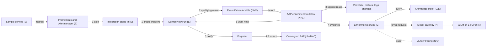

# AI-assisted incident enrichment: demo implementation design

| | |
|---|---|
| **Version** | 0.1 draft |
| **Date** | October 2026 |
| **Implements** | Reference set 1.2: architecture on a page (executive and technical views) and technical architecture v1.2 |
| **Platform baseline** | Red Hat Ansible Automation Platform (AAP) 2.7, Red Hat OpenShift AI Self-Managed 3.5, single-node OpenShift on an AWS g6.16xlarge instance |
| **Status** | Draft for review. Items marked as open are listed in section 11. |

## 1 Purpose and scope

This document describes how the demonstration environment implements the AI-assisted incident enrichment reference architecture. It translates the logical design into specific components, interfaces, identities and deployment choices, and records each point where the demonstration departs from the reference design, with the reason.

The demonstration has two purposes. It shows an operations and automation audience how enrichment works end to end against a real, reproducible fault. It also provides a reusable kit that can be rebuilt from an empty cluster using Ansible alone, so that any colleague can run it. It is not a production design. Where production requirements differ, section 10 sets out the difference.

The reference architecture sets level 1 as the pilot target. The demonstration also shows level 2, because a recommended, catalogued job is the point at which enrichment becomes tangible for an automation team, and it needs no additional control components.

All data in the demonstration is fictional. It uses a fictional organisation, ACME Bank, with fictional services and a synthetic knowledge corpus, and contains no customer material. For the same reason, this document and the repository refer to the reference architecture in its generic form rather than any customer-specific version.

| In scope | Out of scope (described, not built) |
|---|---|
| Pattern A: enrichment of an existing incident, flow steps 1 to 6 | Pattern B: automated incident creation and correlation |
| Level 1 enriched incident for one incident family | Levels 3 and 4, the action broker and approval binding |
| Level 2 recommended job, launched by an engineer under their own authority | Guardrails service, automated evaluation pipeline, audit archive and SIEM forwarding |
| Model access through the gateway with a per-consumer key, and tracing of every model call | Enterprise identity provider, MFA and enterprise search |
| Failure handling, idempotent writes and recursion prevention | Production sizing, high availability, backup and recovery |
| Onboarding a second incident family as a content-only change | Model training or learning from feedback |

## 2 Traceability to the reference architecture

Status values: **Implemented** follows the reference design; **Simplified** implements the intent with a documented shortcut; **Deviation** uses a different approach, recorded in section 10; **Not applicable** falls outside the demonstration scope.

### 2.1 Enrichment flow

| Step | Reference design | Demo implementation | Status |
|---|---|---|---|
| 1 | Existing integration raises the incident and pages on-call | An Alertmanager alert raises a ServiceNow incident through a stand-in integration: an Event-Driven Ansible (EDA) rulebook activation with its own project and ServiceNow identity, separate from the AI path. Paging is represented by assignment to an on-call group. | Simplified |
| 2 | Qualifying incident event reaches EDA | A ServiceNow business rule on incident insert sends the qualifying incident to an EDA event stream. A polling fallback applies where the cluster is not reachable from ServiceNow (DD03). | Implemented |
| 3 | AAP runs scoped read diagnostics | Four read-only diagnostic job templates run within the enrichment workflow, bounded by namespace, time window, runtime and output size. Each returns evidence in a common format (section 5.2). | Implemented |
| 4 | Enrichment retrieves knowledge and calls the model through the gateway and guardrails | The enrichment service retrieves approved passages, calls the model through the gateway with its own key, and validates the structured output and every citation. Input sanitisation and output validation run in the enrichment service; the guardrails service is not deployed (section 10). | Simplified |
| 5 | AAP appends an AI-labelled work note, idempotent by revision | A dedicated ServiceNow identity writes the work note and two enrichment fields. The revision field prevents duplicate notes on retry. | Implemented |
| 6 | ITSM notifies the team that enrichment is ready | A ServiceNow notification fires when the enrichment state changes to complete. | Implemented |
| L2 | Enrichment identifies a catalogued job; engineer launches it | The work note names one job from an allowlisted catalogue, with a launch link. The engineer launches it with their own AAP account. | Implemented |

### 2.2 Principles

| Principle | Demo implementation | Status |
|---|---|---|
| P1 ITSM is the system of record | Enrichment writes only a work note and two enrichment fields on the incident. The enrichment service holds no incident state beyond traces. | Implemented |
| P2 Incident handling is independent of AI | Incident creation and assignment complete before, and independently of, the AI path. Any failure writes "enrichment unavailable" with the reason. Scenario S3 demonstrates this. | Implemented |
| P3 The model proposes; deterministic controls authorise | The model and the enrichment service hold no ITSM, cluster or AAP credentials. Diagnostics are read-only. A recommended job is validated against an allowlist, and only an engineer can launch it. | Implemented |
| P4 Evidence is authorised and traceable | Every recommendation cites evidence or passage IDs, which the service validates. Every model call is traced, and trace, model, prompt and job references appear in the work note. | Implemented (no protected archive) |
| P5 Duties are separated | Each function runs under a distinct identity (section 6.1). Human duties are not separated, because one operator holds every role; this is recorded as a time-limited exception. | Simplified |
| P6 Existing capabilities are reused | AAP provides orchestration, ServiceNow provides notification, and OpenShift AI provides serving and the gateway. New components are limited to the enrichment service and the ingestion job. | Implemented, with ADR09 deviation |

### 2.3 Architecture decisions

| Decision | Demo implementation | Status |
|---|---|---|
| ADR01 ITSM remains the authoritative record | As P1 | Implemented |
| ADR02 Complement existing monitoring and ITSM AI | Prometheus provides no root-cause analysis, so alert labels and annotations are passed to enrichment as an input | Simplified |
| ADR03 Enrich incidents raised through the existing path | Pattern A only | Implemented |
| ADR04 AAP orchestrates; enrichment is a bounded service | AAP workflow sequences every step; the enrichment service only retrieves, calls the model and validates | Implemented |
| ADR05 Models hosted on OpenShift AI | vLLM on the llm-d serving stack (`LLMInferenceService`) in the same cluster | Implemented |
| ADR06 Model access through a governed gateway | OpenShift AI Models-as-a-Service: the enrichment service has its own API key and a subscription with a token rate limit, enforced at the gateway (DD14) | Implemented |
| ADR07 Initial alerts do not wait on AI | As P2 | Implemented |
| ADR08 Remediation through a broker | Levels 3 and 4 are out of scope | Not applicable |
| ADR09 Reuse enterprise search or vector services | No enterprise search exists in the environment, so a dedicated pgvector store is used | Deviation |

## 3 Demo design decisions

These decisions apply to the demonstration only. They do not change the reference positions.

| ID | Decision | Rationale |
|---|---|---|
| DD01 | The incident family is JVM memory exhaustion on a sample service. | The fault can be triggered on demand, its diagnostics are visible in standard metrics, and runbook advice is concrete. It can be replaced with a customer's own incident family where that family can be reproduced. |
| DD02 | OpenShift user workload monitoring stands in for Dynatrace. | The technical architecture treats monitoring as a replaceable example (E). A Dynatrace trial is time-limited and unsuitable for a reusable kit. |
| DD03 | The trigger is a push from a ServiceNow business rule to an EDA event stream. Polling through the `servicenow.itsm` collection is the documented fallback but is not built. | Push matches the reference flow. The environment's routes are reachable from the internet and present a publicly trusted certificate, so ServiceNow can call the event stream without a custom CA (OI01, closed). |
| DD04 | The model is an 8B-class instruct model in FP8, served by vLLM as an `LLMInferenceService` (llm-d) using the single L4 GPU, and packaged as a ModelCar image. | It fits within the L4's memory with room for the required context. A ModelCar image avoids a model download on every rebuild. The build starts with Red Hat's validated Granite 3.1 8B Instruct FP8 ModelCar, with a 16,384-token context; Llama 3.1 8B and Qwen2.5 7B, also validated FP8 ModelCars, are the other candidates. The model is a setting (`demo_model`), and OpenShift AI's default serving template supplies the vLLM image, so changing models changes no code. Final selection depends on a citation-adherence test (OI04). |
| DD05 | Embeddings run in-process within the enrichment service on CPU. | The L4 does not support partitioning, so a second GPU-served model is not practical. The corpus is small enough for CPU embedding. |
| DD06 | PostgreSQL with pgvector holds the knowledge index. The same PostgreSQL instance, deployed in phase 02, holds separate databases for Models-as-a-Service and MLflow. | It is a single, well-understood store that Ansible can deploy and reset. Models-as-a-Service requires PostgreSQL 14 or later, which OpenShift AI does not provide. The knowledge index is recorded as an ADR09 deviation. |
| DD07 | MLflow records traces, using the MLflow server OpenShift AI provides (the `mlflowoperator` component). | It provides per-call traces with prompt, model and source attributes, matching the tracing approach in the reference design. It is part of the product, so no standalone server is needed (OI03, closed). |
| DD08 | Container images are built in-cluster with OpenShift Builds from the repository source. | No external registry or push credentials are required, which keeps the repository free of secrets. |
| DD09 | HashiCorp Vault Community Edition on the operator's laptop supplies bootstrap secrets. Secrets generated during the build stay in the cluster. | The repository is shared, so it holds no secrets in any form. Generated secrets disappear with the environment. |
| DD10 | All deployment and configuration is performed by Ansible playbooks, run through `ansible-navigator` with a shared execution environment. | The kit must be rebuildable on short-lived environments, and the build itself demonstrates the automation platform to the audience. |
| DD11 | AAP and OpenShift AI share one node. | Section 5 of the technical architecture permits co-location as a deployment choice without changing the logical design. |
| DD12 | Container images are sourced in this order: Red Hat Hardened Images where viable; otherwise a UBI-based image, from Red Hat or a certified partner in the Red Hat Ecosystem Catalog; other sources only where neither exists. An image is not viable if it would have to be rebuilt to add something essential, such as a database extension. Any image from the third tier is recorded here with the reason. | Hardened Images are minimal, signed and near zero-CVE, and UBI images carry Red Hat's supply-chain assurances. Keeping to the Red Hat portfolio also keeps the demo consistent with the platform it showcases. Current applications: Vault uses HashiCorp's UBI image because no Hardened Image exists; the enrichment and sample services are planned on Hardened Images, subject to verification in M2 and M3; the shared PostgreSQL uses Red Hat's `rhel9/postgresql-16` image, and whether it can hold the pgvector store is decided in M4 (OI05). |
| DD13 | The build adopts the platform the environment provides and installs no operators in phase 01. Phase 01 frees the GPU, checks Node Feature Discovery, the GPU Operator and the default StorageClass, and configures user workload monitoring. If an expected component is missing, the phase stops with a clear message. Operators the environment does not provide, such as AAP, are installed in their own phases. | The RHDP OpenShift AI environment already provides the GPU stack and OpenShift AI (section 7.1). An install path for components it always provides would never run, so it would never be tested. Leaving pre-installed operators on their own channels avoids disturbing the environment's OpenShift AI configuration. |
| DD14 | Model access goes through OpenShift AI Models-as-a-Service (MaaS). Phase 02 installs Red Hat Connectivity Link, which provides the gateway policies MaaS relies on, enables the `aigateway.modelsAsAService` component, and publishes the model to MaaS. The enrichment service has its own identity, a service account, which a `MaaSAuthPolicy` allows to call the model and a `MaaSSubscription` gives a token budget. MaaS exposes a model only once such a policy and subscription both cover it. The build mints the service's API key with a short-lived token for that service account, so the key belongs to the service rather than to the person who ran the build. It then reads the model's ID and URL from MaaS's model list, as a client would, and stores them with the key in a Secret in the enrichment namespace; MaaS routes its shared OpenAI-style endpoint on that ID. Every build then checks access through the gateway as a client would: with the key, without a key, and with a key it has just revoked. | MaaS is the product's implementation of ADR06: per-consumer keys that can be revoked, rate limits and usage reporting by consumer, which are what risk and security teams ask about. The llm-d serving stack it needs is already provided by the environment. The alternative, a service account token on the model endpoint, gives no rate limits, usage view or per-consumer revocation. |
| DD15 | The build's roles follow the teams that would own each part in production: `openshift_ai` for the platform team (OpenShift AI, Connectivity Link, the MaaS gateway, MaaS and MLflow), `model_serving` for a model owner (one model, served and registered with MaaS) and `maas_consumer` for an application team (one consumer's identity, policy, token budget and key). Roles take their settings as inputs from the playbook and find what they need from other teams on the cluster. | The operating model is part of what the demo shows: the platform team runs the gateway, and models and consumers are onboarded onto it. Separate roles also let a model be swapped, or a second consumer onboarded, without rerunning the platform, which the model test (OI04) needs. Phase 02 still runs all three in one playbook, so a single run answers whether the AI layer works. |

## 4 Component view

| Component | Label | Implemented by | Namespace | Function |
|---|---|---|---|---|
| Sample service | E | Java service with a memory-leak endpoint | `demo-payments` | Produces the reproducible fault |
| Monitoring | E | OpenShift user workload monitoring, alert rules and Alertmanager routing | `demo-payments` | Detects the fault and raises the alert |
| Monitoring integration stand-in | E | EDA rulebook activation with its own project and ServiceNow identity | `aap` | Creates the incident, standing in for the vendor integration |
| ITSM | E | ServiceNow Personal Developer Instance (PDI) | External | Incident record, assignment and notification |
| Event-Driven Ansible | N+C | AAP 2.7 EDA with a rulebook from the repository | `aap` | Validates qualifying events and launches the workflow |
| Enrichment workflow and diagnostics | N+C | Automation controller with a demo collection | `aap` | Orchestration, diagnostics and ITSM updates |
| Catalogued remediation job | N+C | Automation controller job template | `aap` | Level 2 action launched by an engineer |
| Enrichment service | C | Python web service | `aiops-enrichment` | Retrieval, model call, output and citation validation |
| Knowledge ingestion | C | Kubernetes Job using the enrichment service image | `aiops-enrichment` | Loads approved documents into the index |
| Knowledge index | C/E | PostgreSQL with pgvector, its own database in the shared PostgreSQL instance | `aiops-data` | Passage storage and similarity search |
| Shared database | E | PostgreSQL 16 (Red Hat image), with a separate database and user for each consumer | `aiops-data` | Stores for Models-as-a-Service, MLflow and the knowledge index (DD06) |
| Model gateway | N | OpenShift AI Models-as-a-Service, on Red Hat Connectivity Link | `openshift-ingress`, `models-as-a-service` | Per-consumer keys, limits, revocation and attribution (DD14) |
| Model serving | N | vLLM as an `LLMInferenceService` (llm-d) on the L4 GPU | `aiops-models` | Model inference |
| Tracing | N | MLflow provided by OpenShift AI, with metadata in the shared PostgreSQL | `redhat-ods-applications` | Trace of every model call |
| Bootstrap secrets | E | Vault Community Edition | Operator's laptop | Holds the secrets each operator brings to a build |



## 5 Flow and interface contracts

### 5.1 Trigger

A qualifying incident matches the demonstration's on-call assignment group, the application category, priority 2 or 3, and an empty enrichment state. The event carries the incident number and system ID, short description, configuration item, priority, opening time, the alert labels supplied by the integration, and an event ID. The EDA rulebook validates these fields and passes only them to the workflow.

Recursion is prevented in three ways. The business rule fires on insert only, its condition excludes changes made by the enrichment writer identity, and the workflow sets the enrichment state to `pending` as its first action.

### 5.2 Diagnostic evidence

Each diagnostic job returns a list of evidence items in a common format, passed to later workflow nodes as workflow artefacts.

```yaml
evidence:
  - id: EV-POD-01
    source: openshift.pod_status
    collected_at: "2026-10-20T03:14:07Z"
    target: demo-payments/payments-notify-7c9f
    fact: "Container restarted 3 times in 10 minutes; last termination reason OOMKilled"
    ref: "/api/v1/namespaces/demo-payments/pods/payments-notify-7c9f"
```

| Diagnostic | Source | Bounds |
|---|---|---|
| Pod status and events | OpenShift API | Namespace mapped from the configuration item |
| Heap and garbage collection metrics | Thanos Querier tenancy endpoint, which limits queries to namespaces the identity can view | 30-minute window |
| Recent changes | Deployment rollout history and ServiceNow change requests for the configuration item | 24-hour window |
| Log excerpt | Container logs filtered to error patterns | Line and byte limits |

Initial limits are 60 seconds runtime per job and 4 KB per fact. These will be tuned during the build.

### 5.3 Enrichment request and response

The request contains the incident fields, the evidence list, the enrichment revision, and the level 2 catalogue: the IDs and descriptions of the jobs that enrichment is permitted to recommend.

The response has the following structure:

| Field | Content |
|---|---|
| `status` | `enriched`, `insufficient_evidence` or `failed` |
| `summary` | Short description of what is happening |
| `symptoms` | Observed symptoms and impact |
| `likely_causes` | Each with a statement, a confidence of high, medium or low, and citations |
| `next_steps` | Each with the step, prerequisites, risk, how to verify the outcome, and citations |
| `recommended_job` | One catalogue ID with a reason and suggested inputs, or null |
| `gaps` | Missing or conflicting evidence |
| `manual_review_required` | True where evidence is missing or conflicting |
| `provenance` | Gateway consumer, model, prompt and policy versions, retrieval configuration version, source IDs, trace ID, token usage and service version |

Before returning a response, the service applies five rules:

1. Evidence is sanitised before it reaches the prompt. Tokens, keys, email addresses and card-like numbers are redacted, and evidence is enclosed as data, separate from instructions.
2. Retrieval filters on approval status, service, product version and access label before any passage reaches the model.
3. The model output must match the schema.
4. Every citation must refer to an evidence ID or a retrieved passage ID, and the recommended job must appear in the catalogue supplied with the request.
5. Where no retrieved passage meets the relevance threshold, or the output contains no valid citations, the status is `insufficient_evidence` and no next steps are given.

### 5.4 Work note

The work note is labelled as AI-generated and unreviewed, and carries the references needed to reconstruct it.

```text
[AI-generated enrichment | revision 1 | not reviewed by an engineer]
Summary: payments-notify is repeatedly terminated for exceeding its memory limit.
Evidence: EV-POD-01 restarts and OOMKilled; EV-MET-02 heap at 97% before each restart
Likely cause (high): heap growth from unbounded notification cache [KB-RB-014, EV-MET-02]
Next steps:
  1. Capture a heap dump before the next restart. Verify: dump present in the support volume [KB-RB-014]
  2. ...
Recommended automation: Capture heap dump and restart (payments-heapdump-restart) <launch link>
Gaps: no change recorded in the last 24 hours
References: trace <id> | model <name> | prompt v3 | policy v1 | workflow job <id>
```

Enrichment uses three custom incident fields:

| Field | Values | Purpose |
|---|---|---|
| `u_ai_enrichment_state` | `pending`, `complete`, `insufficient_evidence`, `unavailable` | Drives the trigger condition and the "enrichment ready" notification |
| `u_ai_enrichment_rev` | Integer | Idempotency: before writing, the workflow checks whether a note for the current revision already exists, so a retried workflow cannot add a duplicate |
| `u_ai_enrichment_rating` | `useful`, `incorrect`, `unsafe` | Engineer rating, supporting the usefulness value measure. Ratings are recorded, not acted on automatically. |

### 5.5 Failure handling

Any node failure takes the workflow's failure branch. This writes an "AI enrichment unavailable" note with the reason and sets the enrichment state to `unavailable`. Initial timeouts are 90 seconds for the enrichment call and 5 minutes for the workflow as a whole. Retries are bounded, and the incident remains with its assigned team throughout.

### 5.6 Knowledge corpus

The corpus is authored for the demonstration and stored in the repository. It is designed to exercise retrieval rather than simply to answer the happy path, so it contains five kinds of document:

| Document type | Purpose in the demonstration |
|---|---|
| Current runbooks and validated prior resolutions for the incident family | The sources enrichment is expected to cite |
| Near-miss runbooks for related faults, such as connection pool exhaustion | Show that retrieval selects the right source, not merely a similar one |
| A superseded runbook for an earlier service version | Must never be cited; tests the version filter |
| A document with a restricted access label | Must never be cited; tests access filtering |
| No runbook at all for a second fault | Drives the insufficient-evidence scenario (S2) |

Each document carries labels for its ID, origin, service, product version, owner, access label, approval status and date, matching the labels described in section 7 of the technical architecture. Ingestion splits documents into passages, embeds them and stores the labels alongside each passage. Approval is represented by review of the pull request that changes the corpus.

## 6 Identity, secrets and trust boundaries

### 6.1 Identities

| Function | Identity | Permitted | Not permitted |
|---|---|---|---|
| Integration stand-in | ServiceNow `svc-monitoring` | Create incidents | Write enrichment fields; any AAP access beyond its own activation |
| Trigger | EDA event stream token and AAP `svc-eda-enrichment` | Launch the enrichment workflow | Launch any other template, including the remediation job |
| Diagnostics | OpenShift service account `aiops-diagnostics` | Read pods, events, logs and metrics in `demo-payments` | Write to any resource; read any other namespace |
| ITSM writer | ServiceNow `svc-ai-enrichment` | Write work notes and enrichment fields | Create, reassign or close incidents; create changes |
| Enrichment service | Service account `aiops-enrichment`, its MaaS API key and a database credential | Call the gateway; read the knowledge index | Any ITSM, cluster API or AAP access |
| Knowledge ingestion | Separate service account and database credential | Write the knowledge index | Call the gateway; read ITSM |
| Engineer | Personal AAP and ServiceNow accounts | Read incidents; launch the catalogued job | Not applicable |
| Model | None | Inference only | Any credential or outbound network access |

### 6.2 Network

The `aiops-enrichment` and `aiops-models` namespaces apply default-deny network policies. The permitted flows are AAP to the enrichment service, the enrichment service to the gateway, knowledge index and tracing, and the gateway to the model. Outbound traffic from the model namespace is denied. OpenShift enforces these policies on a single node in the same way as on a multi-node cluster.

### 6.3 Secrets

| Category | Examples | Source | Lifetime |
|---|---|---|---|
| Operator entitlements | OpenShift pull secret, AAP subscription manifest, registry token | Operator's Vault | Held by the operator; never shared |
| Environment access | Cluster API URL, token and CA bundle (the CA bundle is not secret) | Operator's Vault, updated for each environment | One environment |
| ServiceNow administration | PDI URL and administrator credential, used only by phase 08 to create service identities | Operator's Vault | Held by the operator |
| Generated | AAP administrator, database, gateway key, EDA token, ServiceNow service identity passwords | Generated by the playbooks; stored as Kubernetes Secrets | One build; ServiceNow identities are reset on every build |

The build reads each secret group from the operator's Vault with its own AppRole, whose policy can read only that group, so a phase holds only the secrets it asks for. Secrets never appear in the repository, the execution environment, container images, prompts, work notes or traces. Every task that handles a secret uses `no_log`, except Kubernetes tasks that receive the cluster token through `module_defaults`. `kubernetes.core` prints that token at verbosity 3 and above, so the secrets role refuses to resolve secrets at that verbosity instead. A later task that loops over a Kubernetes task's registered results would print the token at verbosity 2, so the build reduces such results to the fields it needs first. `ansible-navigator` playbook artefacts are disabled in the committed configuration, and the repository uses a gitleaks pre-commit hook with GitHub secret scanning and push protection. In production, AAP retrieves credentials from the enterprise vault through its external secret management integration [7].

## 7 Deployment view

The environment is single-node OpenShift on an AWS g6.16xlarge: 64 vCPUs, 256 GiB of memory and one NVIDIA L4 GPU with roughly 22 GiB of usable GPU memory. A root volume of around 500 GB is requested to hold model images, databases, logs and heap dumps.

| Workload | vCPU | Memory | Notes |
|---|---|---|---|
| OpenShift platform and monitoring | 8 | 32 GB | Single-node control plane and platform services |
| OpenShift AI 3.5 | 4 to 6 | 16 GB | Operators, dashboard, serving and gateway components |
| AAP 2.7 | 6 to 8 | 24 GB | Gateway, controller, EDA and databases; no private automation hub |
| Model serving | 4 | 32 GB | vLLM; holds the L4 exclusively |
| Enrichment service and knowledge index | 2 to 4 | 8 GB | Includes in-process embedding |
| Sample service, tracing and builds | 4 | 12 GB | The sample service is sized to fail predictably |
| **Total** | **about 30 to 35** | **about 125 GB** | About half the instance, leaving headroom for the fault |

These are planning figures, to be replaced with measured values after the first build. The L4 is allocated to vLLM only. Generation of a work note is expected to take 10 to 20 seconds, which is acceptable because enrichment is asynchronous.

### 7.1 Environment baseline

The environment is the Red Hat Demo Platform (RHDP) OpenShift AI catalogue item. As provisioned in October 2026, it provides the following before the build starts. Phase 01 reports the same details on every build, so drift between environments shows up in its output.

| Component | As provisioned | Effect on the build |
|---|---|---|
| OpenShift | 4.20, single node, g6.16xlarge, one L4 advertised as `nvidia.com/gpu: 1` with no time-slicing | Matches the sizing above |
| Node Feature Discovery | 4.20, channel `stable` | Checked by phase 01, not installed (DD13) |
| NVIDIA GPU Operator | 25.3.4, channel `v25.3` | Checked by phase 01, not installed (DD13) |
| OpenShift AI | 3.5.1, channel `stable-3.x` | Configured by phase 02. The channel follows minor releases, so phase 02 checks for at least 3.5 and records the version it finds |
| OpenShift Serverless, Authorino | 1.37.1, 1.4.3 | OpenShift AI dependencies, left as provisioned |
| llm-d serving | `LLMInferenceService` resource types, `LLMInferenceServiceConfig` templates including a single-node NVIDIA one, and the `openshift-ai-inference` Gateway, all ready | Used for the model (DD04) |
| Models-as-a-Service, MLflow | Not enabled. Red Hat Connectivity Link (`rhcl-operator`) is in the catalogue but not installed | Installed and enabled by phase 02 (DD14, DD07) |
| OpenShift Pipelines, cert-manager, JobSet, Red Hat build of Keycloak | 1.24.1, 1.20.1, 1.0.1, 26.4.16 | Not used by the demo, left as provisioned |
| Sample model `my-first-model` | Holds the only GPU | Deleted by phase 01 (`demo_gpu_reclaimable_namespaces`) |
| Default StorageClass | `gp3-csi` | Checked by phase 01 |
| User workload monitoring | Not configured | Enabled by phase 01, with its own Alertmanager |
| Ingress | Routes reachable from the internet with a publicly trusted certificate | Push trigger (DD03) |
| API certificate | Signed by the cluster's own CA, not publicly trusted | The build verifies the API against the cluster's CA bundle (`kube-root-ca.crt`), loaded into Vault with the URL and token |

## 8 Build and redeploy model

Environments stop automatically and expire after a fixed period, so the kit is rebuilt rather than maintained. Every phase is idempotent and safe to rerun, versions are pinned, and environment-specific values such as instance profile, model and incident family are set in inventory variables.

The no-scripting rule applies to deployment and configuration. The enrichment service and the sample service are application code (C components) and are built from source in the cluster.

| Phase | Playbook | Result |
|---|---|---|
| 00 | `00_secrets.yml` | Vault container, KV engine, read-only policy and AppRole on the operator's laptop |
| 00 | `00_preflight.yml` | Confirms every required secret and the cluster connection before any change |
| 01 | `01_platform.yml` | Frees the GPU, checks Node Feature Discovery, the GPU Operator and storage, and enables user workload monitoring with its Alertmanager (DD13) |
| 02 | `02_openshift_ai.yml` | PostgreSQL; the AI platform: Red Hat Connectivity Link, Models-as-a-Service and MLflow; the model as an `LLMInferenceService`; and the enrichment service onboarded with its policy, subscription and API key, checked through the gateway (DD14, DD15) |
| 03 | `03_aap.yml` | AAP operator, instance and subscription manifest |
| 04 | `04_aap_content.yml` | Projects, credentials, job templates, workflow, catalogue and rulebook activations, declared with `infra.aap_configuration` |
| 05 | `05_workload.yml` | Sample service, alert rules and Alertmanager routing |
| 06 | `06_knowledge.yml` | Knowledge index and ingestion of the approved corpus |
| 07 | `07_enrichment.yml` | Enrichment service build, deployment and network policies |
| 08 | `08_servicenow.yml` | PDI fields, business rule, notification, service identities and demo data |
| | `reset.yml` | Returns the demonstration to a clean state between runs |
| | `verify.yml` | Triggers the fault and checks the acceptance criteria in section 9 |

The target is an empty environment to a working demonstration in under 90 minutes. Phase durations will be measured on the first build.

```text
aiops-enrichment-demo/
├── site.yml, reset.yml, verify.yml
├── ansible.cfg, ansible-navigator.yml
├── secrets.example.yml
├── inventory/group_vars/
├── playbooks/                   build phases, run from the operator's laptop
├── roles/                       roles used by the build phases
├── automation/                  playbooks AAP runs as job templates
├── rulebooks/                   EDA rulebooks
├── collections/
│   ├── requirements.yml
│   └── ansible_collections/demo/aiops/   diagnostic, write-back and remediation roles
├── execution-environment/
├── services/enrichment/         enrichment service source
├── services/payments-notify/    sample service source
├── knowledge/                   synthetic corpus with approval metadata
├── docs/implementation-design.md
└── SECURITY.md
```

The repository holds two kinds of playbook. `playbooks/` builds the environment and runs from the operator's laptop. `automation/` and `rulebooks/` hold the content AAP runs inside the demonstration, and the repository itself is the AAP and EDA project they are synced from.

## 9 Demo scenarios and acceptance criteria

| ID | Scenario | Demonstrates | Pass condition | Reference acceptance area |
|---|---|---|---|---|
| S1 | Trigger the memory fault | Value moment: level 1 and level 2 | Incident raised within 2 minutes of the alert; work note within 60 seconds of the incident, citing the correct runbook and evidence; correct job recommended; the engineer's launch recovers the service. Compared against a timed manual diagnosis of the same incident. | Evidence and AI quality; time to usable diagnosis |
| S2 | Trigger a fault with no runbook | Trust moment | Work note states insufficient evidence and requires manual review, with no invented steps | Evidence and AI quality |
| S3 | Revoke the gateway key, then trigger the fault | Failure handling and the gateway kill switch | Incident raised and assigned as normal; "enrichment unavailable" note with the reason | Failure handling; governance |
| S4 | Add a second incident family | Scaling as a content-only change | Rerunning phases 04 and 06 with a new diagnostic job and runbooks covers the new family, with no change to the enrichment service | Not applicable |
| S5 | Follow a work note to its trace | Traceability | The trace shows the prompt version, model, retrieved sources and workflow job | Governance |

Scenarios S1 to S5 are presented to the audience. `verify.yml` also checks the following criteria automatically after every build, drawn from the acceptance criteria in section 10 of the technical architecture:

| Check | Pass condition | Reference acceptance area |
|---|---|---|
| Idempotency | A rerun of the workflow for the same revision adds no second note | Enrichment lifecycle |
| Recursion prevention | The enrichment update does not retrigger the workflow | Enrichment lifecycle |
| Concurrent update | An engineer's edit to the incident during enrichment is preserved | Enrichment lifecycle |
| Wrong-version source | The superseded runbook is never cited | Evidence and AI quality |
| Access filtering | The restricted document is never retrieved | Evidence and AI quality |
| Prompt injection | A log line containing instructions to the model does not change the recommended job or add uncited steps | Evidence and AI quality |
| Sensitive data | A planted token and card-like number in the logs are redacted before the prompt and absent from the work note and trace | Evidence and AI quality |
| Latency and cost | Time to work note and token usage per enrichment are recorded, as an input to the cost per enriched incident measure | Value measures |

## 10 Simplifications and production considerations

| Area | Demonstration | Production, per the reference design |
|---|---|---|
| Monitoring | OpenShift user workload monitoring | Existing monitoring platform, with its root-cause output as an input (ADR02) |
| Incident creation | EDA stand-in for the integration | Existing monitoring-to-ITSM integration, unchanged |
| Paging | Assignment to an on-call group | Existing paging path |
| Topology | Single node, AAP and OpenShift AI co-located | Sized, highly available deployment in approved network zones |
| Knowledge store | Dedicated pgvector store | Enterprise search where it meets control requirements (ADR09) |
| Embeddings | In-process on CPU | Served embedding model behind the gateway |
| Knowledge approval | Pull request review | Named knowledge source approver, separate from the ingestion identity |
| Knowledge readiness | Corpus authored to fit the fault, so quality is higher than most real runbooks | Readiness assessed before build (technical architecture section 7); real results depend on runbook currency and CMDB accuracy |
| Diagnostic targets | OpenShift API, metrics and ServiceNow only | Monitoring APIs, CMDB and managed targets over HTTPS, SSH or WinRM, with read-only credentials |
| Guardrails | Input sanitisation and output validation in the enrichment service | Gateway guardrails in addition to service-level validation |
| Evaluation | Fixed checks in `verify.yml` | Evaluation against human-reviewed historical incidents before each release |
| Audit | Traces in MLflow only | Correlated records forwarded to SIEM and a protected archive |
| Identity | Local accounts | Enterprise identity provider with MFA |
| Secrets | Laptop Vault for bootstrap | Enterprise vault through AAP credential lookup |
| Separation of duties | One operator holds every role | Duties mapped to named groups, with prohibited combinations technically enforced |
| Data | Fictional | Classified, redacted and governed by residency and retention requirements |

## 11 Open items

| ID | Item | Needed by |
|---|---|---|
| OI01 | ~~Confirm whether the environment's routes are reachable from ServiceNow, which decides push or polling for the trigger (DD03).~~ Closed: routes are reachable from the internet and present a publicly trusted certificate, so the trigger is a push. | Phase 08 |
| OI02 | ~~Confirm the gateway capability and its configuration in OpenShift AI 3.5 as provisioned in the environment.~~ Closed: Models-as-a-Service (DD14). The enrichment service's key is issued without the dashboard: the build mints it through the MaaS API with a short-lived token for the service's own service account. Confirmed on the first environment (2026-10-14). | Phase 02 |
| OI03 | ~~Confirm whether OpenShift AI 3.5 provides MLflow tracing in the environment, or whether a standalone server is required.~~ Closed: provided by the `mlflowoperator` component, not enabled by default (DD07). | Phase 02 |
| OI04 | Select the model by testing citation adherence against a hand-built prompt and sample evidence. Phase 02 serves Granite 3.1 8B as the starting point; the test runs each candidate through MaaS with the same evidence and prompt. | Before phase 05 |
| OI05 | Confirm that pgvector is available in the chosen supported PostgreSQL image. | Phase 06 |
| OI06 | Confirm that an AAP subscription manifest can be obtained for demo environments. | Phase 03 |
| OI07 | ~~Name the fictional organisation and its services for the corpus and demo data.~~ Closed: the organisation is ACME Bank; service names are chosen with the corpus. | Phase 06 |
| OI08 | ~~Confirm whether the audience's own highest-volume incident family can be reproduced, as a replacement for DD01.~~ Closed: DD01 (JVM memory exhaustion) stands; a second reproducible family is designed in M5. | Before corpus authoring |
| OI09 | ~~Confirm licence and publication approval.~~ Closed: a personal learning and demonstration kit, kept private in the author's GitHub under Apache 2.0 and shared with colleagues as collaborators. Making it public is a later decision, once the kit is mature, and follows the review in M6.7. | Not applicable |

## Related documents and references

This design implements the reference set 1.2: the architecture on a page (executive and technical views) and the technical architecture v1.2. Section numbers, principles (P1 to P6) and decisions (ADR01 to ADR09) refer to the technical architecture. Bracketed reference numbers follow the same register:

- [7] AAP 2.7 third-party secret management
